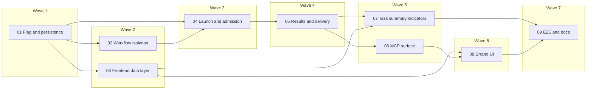
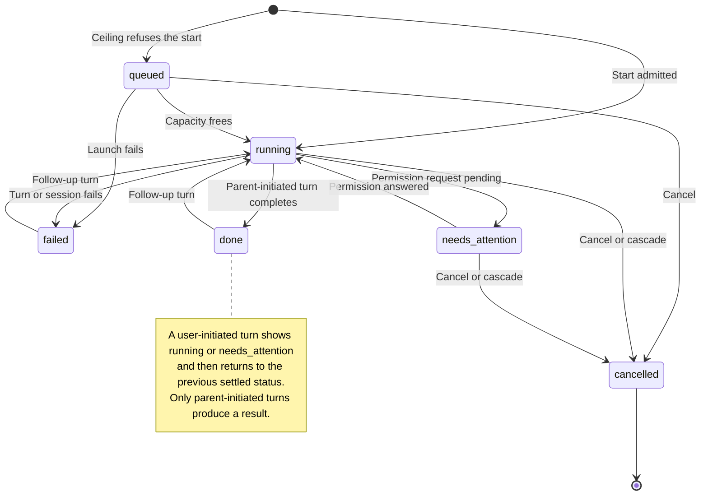
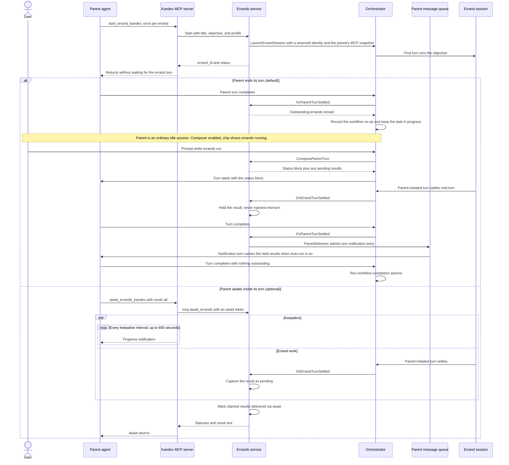
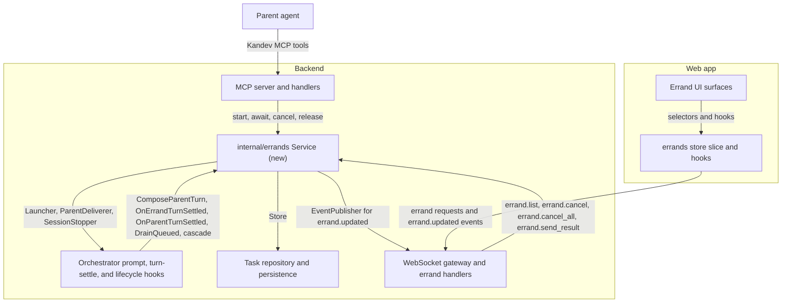
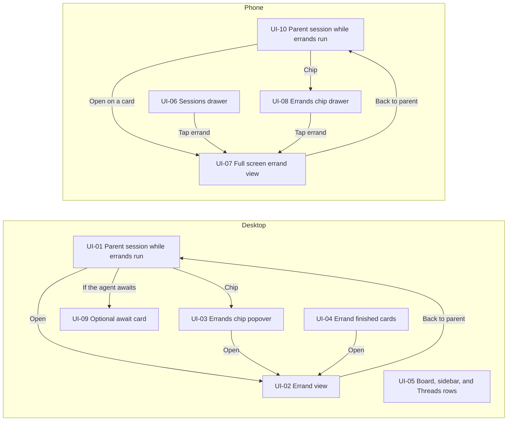

# Implementation Plan: Errands

## Overview

### At a glance

Errands let a task's agent delegate work to visible, steerable child sessions
in the task's shared workspace and get their results back. The parent stays
conversational while errands run: it is an ordinary idle session with an
enabled composer, every turn it starts with errands in flight carries a
compact errand status block, and each result arrives once, through an
optional await, attached to the parent's next turn, or in a notification
turn. An errand starts with a snapshot of its parent's session-level MCP
servers. Nine work orders deliver errands in seven working layers behind
`features.errands`, which stays off in every shipped profile. Isolation lands
before any errand can start, and agents see the tools only after the service
underneath them is complete.

Behavior is defined by the
[requirements](../../specs/tasks/requirements/errands.md), the
[system design](../../specs/tasks/system-design/errands.md), and
[ADR-2026-10-23-errands-first-class-delegation](../../decisions/2026-10-23-errands-first-class-delegation.md).
This plan summarizes them; it does not replace them.

### How errands compare

The ways an agent can split work today, from the ADR's concept table:

| Mechanism | Visible transcript | Follow-ups | Workflow state | Workspace | Result to parent |
| --- | --- | --- | --- | --- | --- |
| Native subagent | Card in the parent transcript; most providers send no child text or thinking | No, for most providers | None | Inside the parent agent process | Provider-defined |
| **Errand** | Own full session transcript | From its parent (`message_task_kandev`) or the user | None; the parent keeps workflow ownership | Task's shared workspace, attach-only | Yes: one bounded result per parent-initiated turn |
| Additional named session (`spawn_session_kandev`) | Own full session transcript | Yes | Peer: runs workflow turn hooks and can become primary | Task's shared workspace | No way to join on a result |
| Subtask | Own task and sessions | Yes | Its own workflow state, board card, and pull request | Own task, optionally its own workspace | Through task completion |

## Diagrams

Each diagram summarizes the linked requirements and system design, which
remain authoritative.

### 1. Work-order dependencies by wave

Read left to right: each box is a wave, and an arrow points from a work order
to one that depends on it. Waves 2 and 5 hold parallel-safe pairs.



### 2. Errand status lifecycle

The six statuses of AC-TASKS-ERRANDS-002.1. Look for the follow-up loop from
`done` or `failed` back to `running`; only `cancelled` never changes again.



### 3. Start, converse, and deliver

Errands start without blocking the parent. In the `alt` block, the top branch
is the default: the parent ends its turn and stays an ordinary idle session,
a user prompt wakes it with the errand status block, a result that settles
mid-turn is held, and a notification turn delivers it. The bottom branch is
the optional in-turn join with an await.



### 4. Where the errands package sits

Arrows point from a caller to what it depends on. The new `internal/errands`
service sits in the middle and reaches the orchestrator, persistence, and
WebSocket layer only through narrow interfaces.



### 5. Result delivery decision

Each result is delivered at most once, by the first of an await, the
parent's next turn, or a notification turn. No batching window or timer
exists: one notification carries every result pending when its turn starts.


When a user prompt starts a turn while a notification waits (Auto-run off),
that turn takes the results and the notification is removed without a turn.

### 6. UI surface map

Where errands appear and how the user reaches an errand view. Labels match
the drawings in [ASCII UI preview](#ascii-ui-preview).



## Work orders

Area: **Backend** is Go only, **Frontend** is web only, **Both** touches
each. Requirement numbers abbreviate `REQ-TASKS-ERRANDS-<NNN>`.

| Wave | ID | Title | Depends on | Area | Requirements |
| --- | --- | --- | --- | --- | --- |
| 1 | [`01-flag-and-persistence`](task-01-flag-and-persistence.md) | Add the errands flag, session role, and errand persistence | None | Both | 001, 012 |
| 2 | [`02-workflow-isolation`](task-02-workflow-isolation.md) | Detach errand sessions from workflow, primary, and routing | 01 | Backend | 005, 012 |
| 2 | [`03-frontend-data-layer`](task-03-frontend-data-layer.md) | Add the errands frontend data layer and tab filter | 01 | Frontend | 010, 012 |
| 3 | [`04-errand-launch-and-admission`](task-04-errand-launch-and-admission.md) | Launch, admit, track, and cancel errands | 01, 02 | Backend | 001, 002, 007, 008, 013 |
| 4 | [`05-errand-results-and-delivery`](task-05-errand-results-and-delivery.md) | Capture errand results and deliver them to a conversational parent | 04 | Backend | 003, 004, 006, 007, 013 |
| 5 | [`06-errand-mcp-surface`](task-06-errand-mcp-surface.md) | Expose errands to agents through MCP and prompts | 05 | Backend | 001, 002, 004, 006, 009, 012 |
| 5 | [`07-task-summary-indicators`](task-07-task-summary-indicators.md) | Show errand counts and waiting status on task rows | 03, 05 | Both | 006, 010 |
| 6 | [`08-errand-ui`](task-08-errand-ui.md) | Build the errand UI for desktop and phone | 03, 06 | Frontend | 003, 005, 007, 010, 011 |
| 7 | [`09-e2e-and-docs`](task-09-e2e-and-docs.md) | Add errand E2E scenarios, public docs, and harness notes | 07, 08 | Both | 003, 004, 005, 006, 007, 010, 011 |

Dependency order and parallel-safe candidates:

| Wave | Layer | Work orders | Why this order |
| --- | --- | --- | --- |
| 1 | Flag, session role, and errand persistence | 01 | Schema, DTO, and flag contract |
| 2 | Workflow and ownership isolation for errand-role sessions, in parallel with the frontend data layer | 02, 03 | Backend isolation and frontend data layer touch disjoint files |
| 3 | Errand launch with the parent's MCP snapshot, admission, status, and cancellation | 04 | Needs isolation before any errand session exists |
| 4 | Results, status block, delivery routes, parent workflow deferral, and restart reconciliation | 05 | Shares the service and orchestrator hooks with 04 |
| 5 | The agent-facing MCP surface and prompts, in parallel with the task summary indicators | 06, 07 | MCP and prompts versus status summary and row indicators; disjoint files and locale namespaces |
| 6 | Errand UI on desktop and phone | 08 | Needs the tool names from 06 and the slice from 03 |
| 7 | End-to-end scenarios, public documentation, and harness notes | 09 | Needs the complete feature |

Progress:

- [x] [Task 01: Add the errands flag, session role, and errand persistence](task-01-flag-and-persistence.md)
- [x] [Task 02: Detach errand sessions from workflow, primary, and routing](task-02-workflow-isolation.md)
- [ ] [Task 03: Add the errands frontend data layer and tab filter](task-03-frontend-data-layer.md)
- [x] [Task 04: Launch, admit, track, and cancel errands](task-04-errand-launch-and-admission.md)
- [x] [Task 05: Capture errand results and deliver them to a conversational parent](task-05-errand-results-and-delivery.md)
- [ ] [Task 06: Expose errands to agents through MCP and prompts](task-06-errand-mcp-surface.md)
- [ ] [Task 07: Show errand counts and waiting status on task rows](task-07-task-summary-indicators.md)
- [ ] [Task 08: Build the errand UI for desktop and phone](task-08-errand-ui.md)
- [ ] [Task 09: Add errand E2E scenarios, public docs, and harness notes](task-09-e2e-and-docs.md)

## Decisions to review

| Topic | Decision |
| --- | --- |
| Release toggle | `features.errands` stays off in every shipped profile. |
| Layer order | Isolation lands before any errand can start, so no errand session can ever leak into workflow, primary, or routing paths. |
| Tool exposure | Agents see the tools only after the service underneath them is complete. |
| Parent while errands run | An ordinary idle session with an informational indicator. Its composer stays enabled, it accepts prompts and agent messages, and every turn that starts with errands in flight gets a status block of at most 10 errands and 4 KiB. |
| Result delivery | First of an in-progress await, the next parent turn (attached to its context), or a notification turn. Results never enter a running turn except through an await. One notification carries every result pending when its turn starts, so results that settle together arrive together and no batching window or timer exists. Auto-run off keeps the notification in the queue. |
| Parent turn cancel | Cancels only the turn, including during an await; errands keep running and the await claims nothing. A user cancel does not queue a notification by itself, matching the parked queue of cancelled turn completion. Stopping, failing, or deleting the parent session still cancels its errands. |
| Stopping errands | Per-errand **Stop**, **Stop all errands** in the chip popover and phone drawer, and `cancel_errand_kandev` for agents. |
| Await | Kept as an optional in-turn join; prompts recommend ending the turn and being notified. |
| MCP servers | An errand inherits a snapshot of its parent's session-level MCP selections at start, on top of its own profile, task, and repository selections. Later parent changes do not propagate; the user can add servers from the errand's composer. Inherited servers never widen the Kandev tool surface. |
| Transcript grouping | No grouped transcript block for consecutive start calls. Each start renders its own row card, and the await card lists the group. |
| Desktop errand list | No dockview Errands panel. Desktop uses the chip popover. |
| Work-order split | The draft plan proposed eight work orders in five waves. The service was split into launch (04) and delivery (05) so each work order stays verifiable in one pass, giving nine work orders in seven waves. |

## Risks

| Risk | Work orders | Detail and mitigation |
| --- | --- | --- |
| Upstream changes in flight | 02 to 06, 09 | Re-check the pull requests in the next table before implementing the listed tasks. |
| Reserved identity on `IntentStart` | 04 | Only automation retry uses `models.ReservedLaunchIdentity` today. Task 04 must prove the start path honors it end to end, or extend it minimally. |
| Turn composition coverage | 05 | Every parent prompt path reaches `promptTask` today. A new path that bypassed it would skip the status block and leave results pending until a later turn; a table test pins the callers. |
| Prompt growth | 05 | Attached results add up to 16 KiB each; the status part stays within 10 errands and 4 KiB. |
| Long MCP calls | 05, 06 | Reduced: await is optional and prompts recommend ending the turn. A client that aborts an await releases its claims, and the next parent turn delivers them. |
| Inherited MCP snapshot | 04 | A definition disabled after the parent selected it would fail `Replace`; the launcher keeps only still-enabled definitions, and a queued errand reuses its stored snapshot. |
| Shared worktree | 06 (prompt) | Parent and errands can write the same files. Prompt guidance and co-residency counters are the only mitigation in v1. |
| Completion handler complexity | 02, 05 | The agent-completed and cancelled-turn completion paths already have many branches; tasks 02 and 05 must add the detached and outstanding branches without reordering clarification, pending-move, and drain behavior. |
| Spec size | All | The requirement and system-design files are within about 150 bytes of their 20 KiB and 32 KiB limits. Further growth needs a split by contract boundary first. |

Upstream pull requests to re-check:

| Pull request | Topic | Why it matters |
| --- | --- | --- |
| [#4720](https://github.com/kdlbs/kandev/pull/4720) | Durable task message operation readback | May change how notification queue admission and turn-token readback are confirmed |
| [#4605](https://github.com/kdlbs/kandev/pull/4605) | Queue hand-off from a terminal primary session | Touches the routing fallback that task 02 changes |
| [#4652](https://github.com/kdlbs/kandev/pull/4652) | Stop of replaced session runtimes | Touches the stop path used for errand cancel |
| [#4765](https://github.com/kdlbs/kandev/pull/4765) | Cleanup of terminal helper sessions | Guards deletion with unresolved queued work and archives helper history; may change the errand-row deletion rule and cancellation of terminal errand sessions (tasks 04, 05) |
| [#4764](https://github.com/kdlbs/kandev/pull/4764) | Keep the exact assigned profile through launch | Same launch path as `ProfileExplicit`; the errand's explicit profile must still win (task 04) |
| [#4721](https://github.com/kdlbs/kandev/pull/4721) | Opt-in shared turn allowances | Adds a refusal on the prompt path that errand and notification turns use; a refusal must leave results pending (tasks 04, 05) |

## Scope

### In scope

| Area | Included | Work orders |
| --- | --- | --- |
| Release toggle | `features.errands` release toggle across profiles, backend, and frontend | 01 |
| Persistence and contracts | `task_sessions.role` and `parent_session_id`, the `task_session_errands` table with the MCP snapshot column, DTOs, and the required-store descriptor | 01 |
| Isolation | One workflow-detached predicate replacing every completion follow-up check in the orchestrator, plus errand exclusions from primary, title, routing, reuse, feeder, CI, and task-state paths | 02 |
| Service | The `internal/errands` service: start, cap, profile resolution, reserved identity, MCP inheritance, ceiling-queued admission, status projection, results, status block, await, turn attachment and notifications, parent workflow deferral, cancellation including **Stop all errands**, reconciliation, and metrics | 04, 05 |
| Agent surface | MCP tools `start_errand_kandev`, `await_errands_kandev`, `cancel_errand_kandev`, the `errand` MCP mode and catalog, backend guards, `list_task_sessions_kandev` fields, `errand.md`, and the flag-gated delegation policy and errand guidance in `kandev-context.md` | 06 |
| UI, coverage, and docs | Desktop and phone UI, the task summary indicators, i18n in all seven shipped locales, mock-agent scenarios, Playwright coverage, public docs, and `AGENTS.md` updates | 03, 07, 08, 09 |

### Out of scope

| Exclusion | Note |
| --- | --- |
| Every exclusion listed in the requirements | Isolated worktrees, depth greater than one, Office, quick chat, configuration, automation, and coordinator errands, user-started errands, native subagent changes, per-errand model overrides, and delivery batching windows or timers |
| A grouped transcript block for consecutive start calls | Each start renders its own row card, and the await card lists the group |
| A dockview Errands panel | Desktop uses the chip popover |
| Live propagation of parent MCP changes | The errand keeps its start snapshot; its own composer adds servers |

## Technical approach

Follow the [system design](../../specs/tasks/system-design/errands.md). Key
boundaries per layer:

| Layer | Work orders | Key files, symbols, and integration points |
| --- | --- | --- |
| Persistence | 01 | Idempotent `ADD COLUMN` migrations in `apps/backend/internal/task/repository/sqlite/base_migrations.go`, then the index; `initErrandsSchema` beside `base_schema.go`; `models.TaskSession.Role` and `ParentSessionID`; `dto.TaskSessionDTO`, `dto.TaskSessionSummaryDTO`, `TaskSession.ToAPI`; the `task` descriptor in `internal/persistence/requiredstores/catalog.go`; `storeconformance` |
| Isolation | 02 | `models.IsWorkflowDetachedSession` and every call site in the design's predicate table, including `Repository.SetSessionPrimary` and a task-state-free waiting settle path |
| Service | 04, 05 | New `apps/backend/internal/errands` package with narrow interfaces. Orchestrator adapters: `LaunchErrandSession` with `MCPServerIDs` (stored by `session_mcp.go`), the `Errand` internal launch field, a new `ErrSessionCeilingRefused` sentinel from `admitOrDeferSeam1`, the `ceilingSweepTick` hook, `ComposeParentTurn` in `promptTask`, turn-settle, stop, cancel, and delete hooks, and notification entries through `messagequeue` |
| MCP and prompts | 06 | `internal/common/mcpmode`, `internal/mcp/profile`, `internal/mcp/server` (`errands` group, `registerErrandTools`, keepalive and release), `internal/mcp/handlers` (four actions, guards, shared workspace conflict helper), `internal/sysprompt`, and `config/prompts` |
| Frontend | 03, 07, 08 | `lib/types`, a new `lib/state/slices/errands`, `lib/ws/handlers/errands.ts`, hooks, Kandev tool renderers, **Errand finished** cards, the errand header, chip and panel with **Stop all errands**, tab filtering, phone nesting, and summary indicators |

### Provider compatibility

| Profile shape | Parent use | Errand use | Evidence | Fallback |
| --- | --- | --- | --- | --- |
| ACP agent with Kandev MCP (Claude, Codex, Cursor, OpenCode, Auggie, and others) | Tools registered; prompts recommend ending the turn; an optional await keeps the call alive with progress notifications | Supported; result is the turn's last agent text message | Mock-agent unit and E2E coverage; manual check per real provider during rollout | A client that aborts long calls gets `pending` or loses the call; results then arrive with the next parent turn |
| Passthrough terminal profile | Not eligible (`errand_not_supported`) | Refused (`errand_profile_incompatible`) | Handler unit tests | None; use a structured profile |
| Remote executors (SSH, Docker, Kubernetes, Sprites) | Same as the ACP row | Same as the ACP row when attach-only reuse is supported | Existing reuse tests plus errand start tests for typed failures | Typed workspace errors; no errand created |

Shared implementation does not prove every real provider honors progress
notifications on long MCP calls; that remains a rollout check.

## Tests

Criteria abbreviate `AC-TASKS-ERRANDS-<NNN.N>`. Superseded criteria (004.1,
004.6, 007.3, and 010.1) have no planned evidence.

| Criteria | Planned evidence |
| --- | --- |
| 001.1 to 001.5 | `internal/errands/service_start_test.go`; `internal/mcp/handlers/errands_test.go` typed errors |
| 001.6 | `internal/errands/service_start_test.go` snapshot; `internal/orchestrator/errand_launch_mcp_test.go` launch selections and no propagation |
| 002.1, 002.2 | `internal/errands/status_test.go` projection table |
| 002.3 | `internal/mcp/handlers/list_task_sessions_errand_test.go` |
| 003.1 to 003.5 | `internal/errands/results_test.go`; `internal/orchestrator/errand_turn_settle_test.go` |
| 004.2 to 004.5, 004.7, 004.9 to 004.12 | `internal/errands/delivery_test.go`, `await_test.go`, `notification_test.go`; `internal/orchestrator/errand_turn_compose_test.go`; `internal/mcp/server/errand_tools_test.go` keepalive and release |
| 004.8 | `internal/errands/reconcile_test.go` |
| 005.1 to 005.5 | `internal/task/models/workflow_detached_test.go`; `internal/orchestrator/errand_isolation_test.go`; `internal/task/service/errand_isolation_test.go`; `components/task/session-tab-menu.test.tsx` |
| 006.1 to 006.5 | `internal/orchestrator/errand_parent_turn_test.go`; `internal/mcp/handlers/errands_test.go` step completion guard |
| 006.6 | `internal/errands/status_block_test.go` bounds, order, and flag-off |
| 007.1, 007.2, 007.4 to 007.6 | `internal/errands/cancel_test.go`; `internal/orchestrator/errand_cascade_test.go`, `errand_turn_cancel_test.go` |
| 008.1 to 008.3 | `internal/errands/service_start_test.go`; `internal/orchestrator/errand_ceiling_test.go` |
| 009.1 to 009.6 | `internal/mcp/server/server_errand_mode_test.go` catalogs; `internal/mcp/handlers/errand_guards_test.go`; `internal/sysprompt/errand_context_test.go` golden text |
| 010.2 to 010.9 | Renderer, header, chip, panel, slice, and selector Vitest files named in tasks 03 and 08; desktop E2E |
| 011.1 to 011.5 | `mobile-sessions-section.test.tsx`; phone E2E |
| 012.1 to 012.3 | `internal/runtimeflags` and profile contract tests; `features-contract.test.ts`; flag-off handler and prompt tests |
| 013.1, 013.2 | `internal/errands/metrics_test.go` label sets |

## E2E tests

Both specs enable the flag with `backend.useEnv({ KANDEV_FEATURES_ERRANDS: "true" })`
and drive errands with the new mock-agent `/e2e:errands` scenario (start three
errands and end the turn) and `/e2e:errands-await` (start two and await).
Criteria abbreviate `AC-TASKS-ERRANDS-<NNN.N>`.

| Spec | Project | Flow | Criteria |
| --- | --- | --- | --- |
| `apps/web/e2e/tests/session/errands.spec.ts` | `chromium` | Parent starts three errands and ends its turn; cards update live; no errand tabs appear; the composer stays enabled and a user prompt gets a reply that reports its status block; **Open** shows the errand view with **Stop** only while live; a follow-up reaches the errand; finished errands arrive as **Errand finished** cards in a notification turn; cancelling a parent turn during an await leaves its errands running; **Stop all errands** in the popover cancels the rest; the board card shows the count and waiting status; the task stays in progress until the final parent turn | 003.1, 003.5, 004.10, 004.11, 005.4, 006.1 to 006.3, 006.5, 006.6, 007.1, 007.5, 007.6, 010.2 to 010.5, and 010.7 to 010.9 |
| `apps/web/e2e/tests/session/mobile-errands.spec.ts` | `mobile-chrome` | Sessions drawer nesting; full screen errand view with back; actions menu with **Stop** while live; chip drawer with **Stop all errands**; **Errand finished** cards at full width with the composer enabled; 44px targets; internal scrolling; no horizontal overflow | 011.1 to 011.5 and 010.6 |

## ASCII UI preview

The [UI surface map](#6-ui-surface-map) shows how these views connect.
Spacing, glyphs, and copy are illustrative; copy is localized and uses
existing `@kandev/ui` primitives and tokens.

| Structural requirement | Views |
| --- | --- |
| Errand row cards, the optional await card, and **Errand finished** cards in the parent transcript | UI-01, UI-04, UI-09 |
| No automatic errand tabs | UI-01, UI-02 |
| The parent composer stays enabled while errands run | UI-01, UI-10 |
| The errand header; **Stop** and **Send result to parent** never appear together | UI-02, UI-07 |
| A chip only when errands exist, showing the live count | UI-01, UI-10 |
| Grouping by parent and **Stop all errands** | UI-03, UI-06, UI-08 |
| Phone nesting, full screen errand view, visible actions menu, and bottom drawer | UI-06, UI-07, UI-08 |

| View | Surface and state | Criteria (`AC-TASKS-ERRANDS-`) |
| --- | --- | --- |
| UI-01 | Desktop parent session after starting three errands and ending its turn | 010.2, 010.4, 010.7, 010.9 |
| UI-02 | Desktop errand view, live and after a user follow-up | 010.2, 010.3, 007.1, 003.3 |
| UI-03 | Desktop chip popover | 010.4, 010.8 |
| UI-04 | **Errand finished** cards in the parent transcript | 010.7, 004.10, 004.11 |
| UI-05 | Board card, sidebar row, and Threads row | 010.5, 006.3 |
| UI-06 | Phone Sessions drawer | 011.1 |
| UI-07 | Phone errand view, full screen | 011.1, 011.3 |
| UI-08 | Phone errands drawer from the chip | 011.2, 011.4 |
| UI-09 | Desktop await card when the agent awaits inside its turn | 010.7, 004.2 |
| UI-10 | Phone parent session while errands run | 011.5, 010.4 |

UI-01: Desktop parent session after starting three errands and ending its turn (AC-TASKS-ERRANDS-010.2, 010.4, 010.7, 010.9).

```text
+-------------------------------------------------------------------------+
| [* Main (Claude)] [+]                                                   |  <- no errand tabs added
+-------------------------------------------------------------------------+
|  Agent: Splitting this into three errands. I will continue when they    |
|         report back.                                                    |
|  +-------------------------------------------------------------------+  |
|  | Errand  API audit       Codex / gpt-5.6    Running       [Open]   |  |  <- one row per start call
|  +-------------------------------------------------------------------+  |
|  | Errand  Schema review   Claude / sonnet    Done          [Open]   |  |
|  +-------------------------------------------------------------------+  |
|  | Errand  Test plan       Cursor             Needs you     [Open]   |  |
|  +-------------------------------------------------------------------+  |
|                                     (turn ended; parent is idle)        |
|-------------------------------------------------------------------------|
| [Errands: 2 running]   ...existing status bar items...                 |  <- chip only when errands exist
| [ Message Main...                                                Send ] |  <- composer stays enabled
+-------------------------------------------------------------------------+
```

UI-02: Desktop errand view, live and after a user follow-up (AC-TASKS-ERRANDS-010.2, 010.3, 007.1, 003.3).

```text
Live errand: Stop only
| [* Main (Claude)] [Errand: API audit] [+]                               |  <- tab added only on Open
| < Main  /  Errand: API audit                                     [Stop] |  <- Stop only while live
| Codex / gpt-5.6 . Running 2m . ~/.kandev/tasks/auth (feat/auth)         |
| Objective: Audit /api/v1 handlers for missing authorize calls  [More]   |
|-------------------------------------------------------------------------|
| ...full transcript: thinking, tool calls, diffs (scrolls)...            |
|-------------------------------------------------------------------------|
| [ Follow up with this errand...                                  Send ] |

Done after a user-initiated turn: Send result only
| < Main  /  Errand: API audit                    [Send result to parent] |  <- only when eligible
| Codex / gpt-5.6 . Done 6m . ~/.kandev/tasks/auth (feat/auth)            |
```

**Stop** shows only while the errand is live. **Send result to parent** shows
only when the errand is done or failed and its latest settled turn is not yet
a result, so the two never appear together. The tab menu omits
**Set as Primary** and **Handoff**, and the composer keeps the MCP explorer.

UI-03: Desktop chip popover (AC-TASKS-ERRANDS-010.4, 010.8).

```text
                 +----------------------------------------------+
                 | Errands                            3 total   |
                 |----------------------------------------------|
                 | Main (Claude)                                |  <- one group per parent
                 |   API audit       Running     2m     [Open]  |
                 |   Schema review   Done        4m     [Open]  |
                 |   Test plan       Needs you   1m     [Open]  |
                 |----------------------------------------------|
                 |                        [Stop all errands]    |  <- only while an errand is live
                 +----------------------------------------------+
```

UI-04: **Errand finished** cards in the parent transcript (AC-TASKS-ERRANDS-010.7, 004.10, 004.11).

```text
Notification turn: no user text, one card per delivered result
|  +- Errand finished ------------------------------------------------+  |
|  |  Schema review    Done                                  [Open]   |  |
|  |    "No breaking changes; two nullable columns added."            |  |
|  +------------------------------------------------------------------+  |
|  +- Errand finished ------------------------------------------------+  |
|  |  Test plan        Cancelled by you                      [Open]   |  |
|  +------------------------------------------------------------------+  |

Result attached to a user prompt
|                                    You: Any news on the API audit?     |
|  +- Errand finished ------------------------------------------------+  |  <- attached to this turn
|  |  API audit        Done                                  [Open]   |  |
|  |    "Three handlers skip authorize; details in the errand."       |  |
|  +------------------------------------------------------------------+  |
|  Agent: The audit found three handlers without authorize calls...      |
```

UI-05: Board card, sidebar row, and Threads row (AC-TASKS-ERRANDS-010.5, 006.3).

```text
+----------------------------------+
| Add auth to API                  |
| [2 errands]   Waiting on errands |  <- informational; absent when none
+----------------------------------+
```

UI-06: Phone Sessions drawer (AC-TASKS-ERRANDS-011.1).

```text
+--------------------------------+
| Sessions                       |  <- fixed header
|--------------------------------|
| Main (Claude)         *    [.] |
|   API audit     Running    [>] |  <- nested under parent, 44px rows
|   Schema review Done       [>] |
| Reviewer (Codex)           [.] |
+--------------------------------+
```

UI-07: Phone errand view, full screen (AC-TASKS-ERRANDS-011.1, 011.3).

```text
+--------------------------------+
| < Main        API audit    [.] |  <- back to parent; [.] holds Stop while live,
| Codex . Running 2m             |     or Send result to parent when eligible
| Objective: Audit /api/v1 ...   |
|--------------------------------|
| ...transcript (only scroller)..|
|--------------------------------|
| [ Follow up...          Send ] |  <- clears the safe area
+--------------------------------+
```

UI-08: Phone errands drawer from the chip (AC-TASKS-ERRANDS-011.2, 011.4).

```text
+--------------------------------+
| Errands                    [x] |  <- inset bottom drawer
|--------------------------------|
| Main (Claude)                  |
|   API audit     Running    [>] |  <- list scrolls inside the drawer
|   Schema review Done       [>] |
|   Test plan     Needs you  [>] |
|--------------------------------|
| [      Stop all errands      ] |  <- fixed footer, 44px, only while one is live
+--------------------------------+
```

UI-09: Desktop await card when the agent awaits inside its turn (AC-TASKS-ERRANDS-010.7, 004.2).

```text
|  Agent: I need the schema review before I edit the migration.         |
|  +- Waiting for 2 errands -----------------------------------------+  |  <- optional in-turn join, live
|  |  Schema review    Running                                       |  |
|  |  Test plan        Needs attention                               |  |
|  +-----------------------------------------------------------------+  |
```

UI-10: Phone parent session while errands run (AC-TASKS-ERRANDS-011.5, 010.4).

```text
+--------------------------------+
| < Tasks   Main (Claude)    [.] |
|--------------------------------|
| Agent: Splitting this into     |
| three errands...               |
| [Errand  API audit  Running >] |
| +- Errand finished ----------+ |  <- full width, no horizontal scroll
| | Schema review  Done  [Open]| |
| | "No breaking changes..."   | |
| +----------------------------+ |
|--------------------------------|
| [Errands: 2 running]           |  <- chip opens UI-08
| [ Message Main...       Send ] |  <- composer stays enabled
+--------------------------------+
```

## Verification results

Design validation on 2026-10-26:

| Check | Result |
| --- | --- |
| `python3 scripts/list-docs.py validate` | Passed, 404 decisions and 1742 specifications |
| `python3 scripts/lint-spec-files.py --all` | Passed; requirements 20,424 of 20,480 bytes, system design 32,622 of 32,768 bytes |
| `python3 scripts/lint-spec-files.test.py` | Passed, 36 tests |
| `.github/scripts/pr-docs.cjs` `validateCoverage` | Covered for all nine work orders with prospective backend and frontend changes |
| Mermaid parse of every changed block | Six plan blocks and the issue draft block parse |
| Acceptance criterion assignment | All 67 active criteria assigned; superseded 004.1, 004.6, 007.3, and 010.1 unassigned; 2 or 3 acceptance conditions per work order |
| Whitespace, em dash, and non-ASCII checks | Passed |

Implementation verification is pending.
