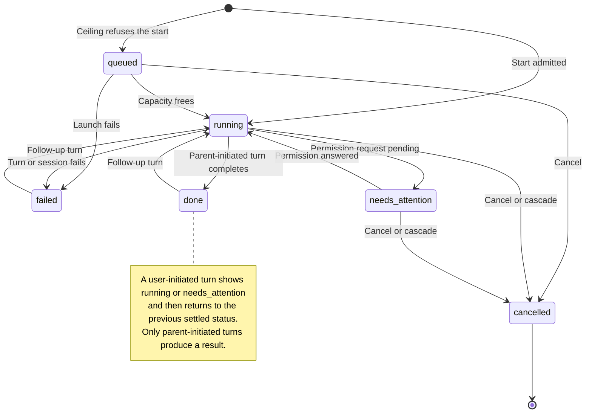
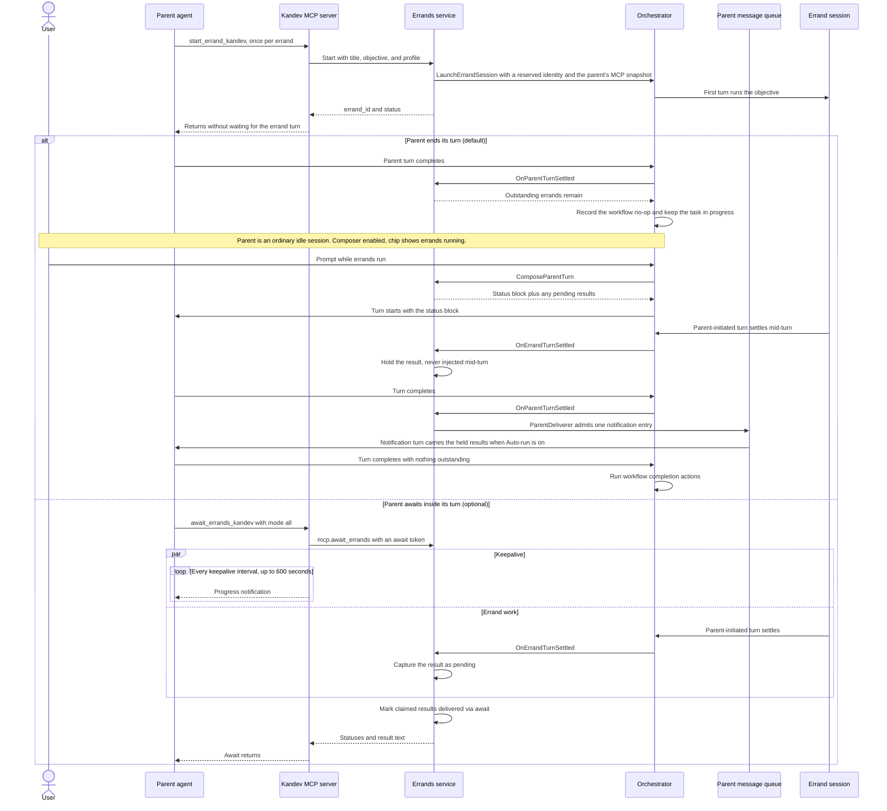
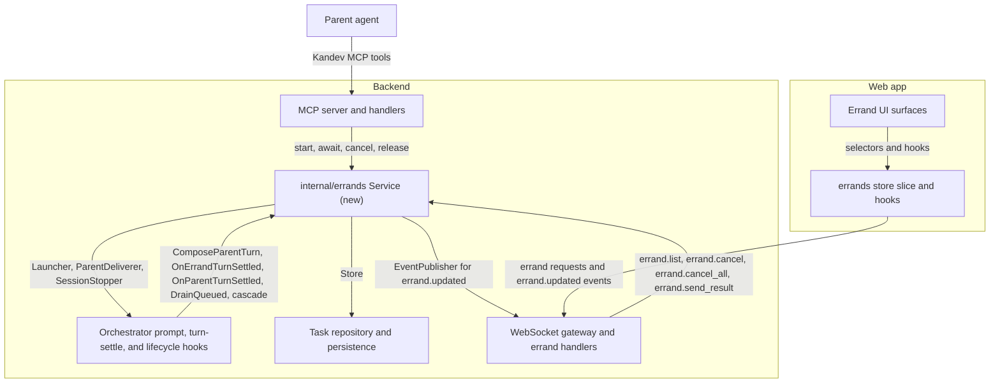
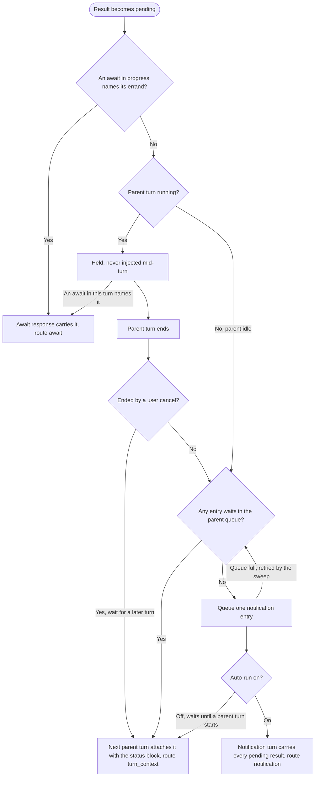
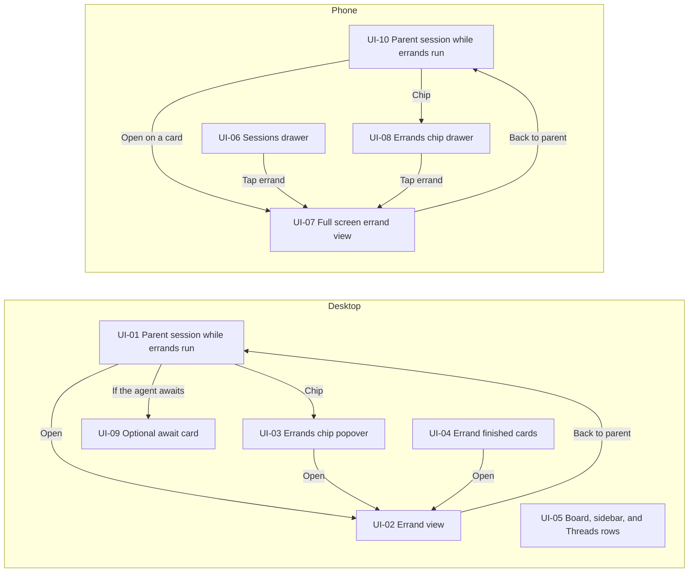

# Implementation Plan: Errands

## Accepted UI refinement (2026-10-30)

Personal use confirmed the status-bar pill and its panel as the preferred
management entry point. Keep its task-wide parent groups, live and completed
errands, Open, attention/live counts, and Stop all while work is live. Retain
compact start entries, optional await entries, and separate immutable delivered
result cards at their historical message positions. Remove the task-wide
current inventory from the transcript: it repeats the panel's controls and
the delivered card's identity/status while consuming conversation space.

This supersedes the UI-11 inline inventory and its 010.10/011.6 criteria with
010.11/011.7 in the owning requirements. The completed task 13 and earlier
previews/results below describe the delivered baseline, not the next target.
Implemented and verified on 2026-10-30 in
[task 14](task-14-pill-owned-management.md): the duplicate inventory and its
exclusive transcript slot are removed. Targeted frontend checks passed 183
tests; managed production-build browsers passed eight desktop and five phone
cases, including immutable history, completed access and scrolling. Typecheck
(with a 6 GiB Node heap), changed-file lint, i18n and docs checks passed. Public
coordination docs now describe the pill/panel flow. Evidence is in
`/tmp/errands-refinement-20261030`. The provider pilot entry point was migrated
but no new real-provider certification is claimed.

Desktop keeps the pill's popover; phone keeps the existing bottom drawer,
44px targets, safe-area clearance and internal list scroller. Open shows a
full-screen child with Back. Chat keeps one scroller and preserves a
scrolled-up reader and bottom-follow. Both paths retain access after all
errands finish. Reuse the shipped Errands drawer and shared domain hooks;
no new counter, loader, mutation or backend contract is needed.

The original checkpoint recorded design only. The later explicit implementation
request authorizes source, test and documentation updates for this refinement.

## Context window follow-up (UI-12)

Proposed on 2026-10-30 after the user delegated the trade-off decision. Worth
adding: the opened child already has the full context widget, and the workspace
already delivers readings for unopened children. A small passive row readout
helps spot a child nearing its limit without changing the pill or reintroducing
an inventory in chat. The tasks-owned
[requirements](../../specs/tasks/requirements/errand-context-window.md) and
[design](../../specs/tasks/system-design/errand-context-window.md) isolate this
context contract from the near-limit main Errands documents.

[Task 15](task-15-context-window.md) is done after completed task 14. It reuses the child session's shared metadata/cache with detail subscriptions disabled and one pure interpretation helper for the existing widget and the new row. Missing/invalid reports remain absent, known-but-unmeasured usage is explicit, and reset clears are authoritative. The corrected bounded backend summary projection restores persisted readings without extra requests, polling, full metadata or DTO changes. Task15 evidence includes 121 unit tests, desktop 11/11, phone 8/8, SQLite/service checks and actual PostgreSQL projection execution. Parent inspected the PostgreSQL pass, scratch shutdown and explicit ownership release; acceptance is complete, delivery remains separate.

### ASCII UI preview

UI-12 (AC-TASKS-ERRANDS-CONTEXT-001.1 through .4), entered from the existing
pill. Labels and values are illustrative; secondary context and existing Open
behavior are required. Context occupancy remains separate from errand status.

```text
Desktop popover                     Phone bottom drawer
Parent                              Parent
  Child A / profile                   [ Child A / profile           > ]
  Running / elapsed      [Open]       [ Running / elapsed             ]
  Context 68%                         [ Context 68%                   ]
  Child B / profile                   [ Child B / profile           > ]
  Running / elapsed      [Open]       [ Running / elapsed             ]
  Context: not measured               [ Context: not measured         ]
[Stop all errands]                  [Stop all errands]  fixed footer
```

Unknown context omits the line. The existing Errands drawer supplies the phone
composition, safe-area clearance and internal list scrolling. Its entire row
stays one 44px target; context is passive accessible text, not a nested ring
button. Desktop retains separate Open. Phone Open/Back and the full child's
context details stay as shipped. Retain 44px targets in narrow fine-pointer
phone layouts and allow long localized labels to wrap without page overflow.

Verification is one sequential work order: shared helper/hook/widget tests,
existing event/store regressions, exact-file lint, typecheck and localization,
then managed desktop/phone Errands and existing context-source browser suites.
The work order names exact commands and the persisted workspace-event fixture.
No new provider certification is claimed. Follow-up implementation and rendered
verification are pending; this turn changes the design package only. Catalog,
specification lint/tests, PR-documentation coverage preflight and scoped diff
checks passed for the package.

## Current delivery checkpoint (2026-10-29)

Final acceptance checkpoint: merge `28e3cd57b8` includes upstream
`b767ca83fd3792f2e0fbc66909dce32af3cf2dff`. The product fix and browser
fixture corrections are committed in `666d79d31f`. Merged-tree Go checks
passed, including Errands and queue race suites, SQLite and real PostgreSQL
repository coverage, PostgreSQL store conformance under race, orchestration,
recovery, configuration, history retention and SQL guard. The earlier broad
PostgreSQL run timed out and is not a pass. Frontend acceptance passed 24
suites and 271 tests, typecheck, localization and changed-file lint. Managed
production browser runs passed eight desktop and four phone cases, including
changed-files scrolling. A disposable SQLite Codex ACP pilot using
`gpt-6-luna` with max reasoning and the worktree executor passed actual
start, delivery, follow-up, independent cancellation and flag-off restart;
it does not certify other providers, executors or a PostgreSQL pilot. Shipped
profiles remain off. Older array-only binaries cannot read snapshots containing
MCP exclusions; the tested rollback disables the flag and restarts the current
binary. The separate Landing publication build was unavailable and is not
claimed. Raw checks and the original snapshot remain in
`/tmp/errands-delivery-20261029`.

The owner authorized sequential completion, logical commits, a fresh upstream
merge, and push to `origin` (`luancm/kandev`) only. No pull request, upstream
push, live-instance mutation, or shipped-default promotion is authorized.
Outstanding work was preserved before merging: `3cd5cb2e25` (plans/specs),
`a1071b3a91` (reliability), and `6793dc3361` (board/sidebar). All 99 original
changed paths survive; only five were reformatted by the normal hooks.

The first refreshed upstream boundary was `dc2d77359f`. Three frontend conflicts
were resolved by combining Errands state/header behavior with upstream read
retirement and queue layout in merge commit `7032b395ce`. Normal hooks passed
after the cold lint cache was populated; the extended lint reported zero
issues. PostgreSQL 16 now runs only in a
disposable user-owned `/tmp` directory. Real PostgreSQL checks exposed and
fixed connection-string quoting, optional queue cleanup transaction aborts,
and UTC timestamp interpretation. Focused Errands persistence/deletion and
non-UTC recovery regressions pass; the broad PostgreSQL run exceeded its
package timeout and is not recorded as passing.

07B (`3541b0aaf0`) and 13 (`0c5e2abc4e`) are committed. The combined focused
frontend acceptance run passed 24 suites and 266 tests; typecheck, exact-file
lint, translation validation and ratchets passed. Browser and selected-provider
checks remain in progress.
Threads Open/Back now has a column-owned navigation regression. Browser
fixtures capture actual start-returned IDs and use causal file gates. Desktop
and phone discovery finds eight and four tests respectively, including the
existing changed-files scroll regressions. No browser or real-provider pass
is claimed yet. Primary is the sole writer; persistent child reservations
remain inactive. Logs and the original snapshot are under
`/tmp/errands-delivery-20261029`.

The first actual desktop run passed the changed-files scroll regression and
cap/cancellation flow, then exposed delivery blockers: the merged upstream
workflow-outcome allowlists rejected `errands_outstanding`; notification
readiness lazily created a parent turn; and optional-await could miss the
child's later authoritative idle-state change. Each has a red regression.
The receipt/retention fix passes SQLite and PostgreSQL; notification checks
now use nonmutating turn reads; session persistence wakes parent awaiters
without changing status projection. Full Errands race checks and mock MCP
checks pass. The corrections are committed in `33206ec0ca` and deterministic
browser fixtures in `6b5d983acc`. Browser reproof remains required. Merge
`36f63e09bf` integrates upstream `da9ff6332863` and its new session MCP
exclusions: admission snapshots preserve additions and exclusions, queued
launches retain that snapshot, and exclusions take precedence over additions.
SQLite/PostgreSQL persistence, queued launch, resolver and focused race checks
passed on that merged tree. Legacy array snapshots remain readable; earlier
array-only builds cannot decode new rows that contain exclusions. The supported
pilot rollback disables the flag and restarts the current binary. Upstream has
since advanced to `b767ca83fd37`; that merge and refreshed checks are pending.

## Overview

### At a glance

Errands let a task's agent delegate work to visible, steerable child sessions
in the task's shared workspace and get their results back. The parent stays
conversational while errands run: it is an ordinary idle session with an
enabled composer, every turn it starts with errands in flight carries a
compact errand status block, and each result arrives once, through an
optional await, attached to the parent's next turn, or in a notification
turn. An errand starts with a snapshot of its parent's session-level MCP
servers. The original work orders established the foundation and session UI.
The continuation below closes delivery and lifecycle gaps, finishes task-row
indicators, and proves an opt-in daily-use delivery. `features.errands` stays
off in every shipped profile; no upstream proposal or publication is part of
this planning turn.

Behavior is defined by the
[requirements](../../specs/tasks/requirements/errands.md), the
[system design](../../specs/tasks/system-design/errands.md), and
[ADR-2026-10-23-errands-first-class-delegation](../../decisions/2026-10-23-errands-first-class-delegation.md).
This plan summarizes them; it does not replace them.

### How errands compare

The ways an agent can split work today, from the ADR's concept table:

| Mechanism | Visible transcript | Follow-ups | Workflow state | Workspace | Result to parent |
| --- | --- | --- | --- | --- | --- |
| Native subagent | Card in the parent transcript; most providers send no child text or thinking | No, for most providers | None | Inside the parent agent process | Provider-defined |
| **Errand** | Own full session transcript | From its parent (`message_task_kandev`) or the user | None; the parent keeps workflow ownership | Task's shared workspace, attach-only | Yes: one bounded result per parent-initiated turn |
| Additional named session (`spawn_session_kandev`) | Own full session transcript | Yes | Peer: runs workflow turn hooks and can become primary | Task's shared workspace | No way to join on a result |
| Subtask | Own task and sessions | Yes | Its own workflow state, board card, and pull request | Own task, optionally its own workspace | Through task completion |

## Diagrams

Each diagram summarizes the linked requirements and system design, which
remain authoritative.

### 1. Continuation dependencies

Historical foundations 01-06 and 08 are recorded done. Execute the remaining
work sequentially: **00 upstream baseline -> 10 delivery snapshots -> 11
notification dispatch -> 12 lifecycle convergence -> 07 task indicators ->
13 inline chat summary -> 09 browser proof and operating guide**. The work-order table below is the
current dependency manifest; historical wave numbers do not authorize workers.

### 2. Errand status lifecycle

The six statuses of AC-TASKS-ERRANDS-002.1. Look for the follow-up loop from
`done` or `failed` back to `running`; only `cancelled` never changes again.



### 3. Start, converse, and deliver

Errands start without blocking the parent. In the `alt` block, the top branch
is the default: the parent ends its turn and stays an ordinary idle session,
a user prompt wakes it with the errand status block, a result that settles
mid-turn is held, and a notification turn delivers it. The bottom branch is
the optional in-turn join with an await.



### 4. Where the errands package sits

Arrows point from a caller to what it depends on. The new `internal/errands`
service sits in the middle and reaches the orchestrator, persistence, and
WebSocket layer only through narrow interfaces.



### 5. Result delivery decision

Each result is delivered at most once, by the first of an await, the
parent's next turn, or a notification turn. No batching window or timer
exists: one notification carries every result pending when its turn starts.



When a user prompt starts a turn while a notification waits (Auto-run off),
that turn takes the results and the notification is removed without a turn.

### 6. UI surface map

Where errands appear and how the user reaches an errand view. Labels match
the drawings in [ASCII UI preview](#ascii-ui-preview).



## Work orders

Area: Backend is Go, Frontend is web, Both spans the contract. Requirement
numbers abbreviate `REQ-TASKS-ERRANDS-<NNN>`. A completed historical work order
is not acceptance of a newly found gap; the continuation owns those deltas.

| Wave | ID | Outcome | Depends on | Area | Requirements |
| --- | --- | --- | --- | --- | --- |
| 1 | [01](task-01-flag-and-persistence.md) | Flag, immutable role and persistence (done) | None | Both | 001, 012 |
| 2 | [02](task-02-workflow-isolation.md) | Workflow/primary/routing isolation (done) | 01 | Backend | 005, 012 |
| 2 | [03](task-03-frontend-data-layer.md) | Store, transport and tab filtering (done) | 01 | Frontend | 010, 012 |
| 3 | [04](task-04-errand-launch-and-admission.md) | Launch, queue, MCP snapshot and cascades (done) | 01, 02 | Backend | 001, 002, 007, 008, 013 |
| 4 | [05](task-05-errand-results-and-delivery.md) | Initial results/delivery (historically done) | 04 | Backend | 003, 004, 006, 007, 013 |
| 5 | [06](task-06-errand-mcp-surface.md) | Parent tools, child catalog and prompts (done) | 05 | Backend | 001, 002, 004, 006, 009, 012 |
| 6 | [08](task-08-errand-ui.md) | Desktop/phone session UI (component-tested) | 03, 06 | Frontend | 003, 005, 007, 010, 011 |
| 8 | [00](task-00-upstream-baseline.md) | Integrate current canonical upstream (done) | None | Both | 005, 009, 012 |
| 9 | [10](task-10-delivery-snapshots.md) | Persist result-card snapshots and recover claims | 00, 05 | Both | 003, 004, 010 |
| 10 | [11](task-11-notification-dispatch.md) | Wake parent, Send now and safe fallback acceptance | 10 | Backend | 004, 006, 007 |
| 11 | [12](task-12-lifecycle-convergence.md) | Cancellation, disabled paths and live convergence | 11 | Both | 002, 003, 005, 006, 007, 008, 012, 013 |
| 12 | [07](task-07-task-summary-indicators.md) | Finish board/sidebar/Threads indicators and nesting | 03, 05, 12 | Frontend | 006, 010 |
| 13 | [13](task-13-inline-chat-summary.md) | Interactive current-Errands card inside chat | 07, 08 | Frontend | 010, 011 |
| 14 | [09](task-09-e2e-and-docs.md) | Desktop/phone E2E, operating guide and pilot evidence | 13, 08 | Both | 003, 004, 005, 006, 007, 008, 009, 010, 011, 012 |
| 15 | [14](task-14-pill-owned-management.md) | Pill-owned management; compact transcript history (done) | 13, 09 | Frontend | 010, 011 |
| 16 | [15](task-15-context-window.md) | Passive per-child context occupancy with bounded reload projection (done) | 14 | Task sessions + frontend | ERRANDS-CONTEXT-001 |

Progress:

- [x] Tasks 01-06 and 08: historical implementation/results retained.
- [x] Task 00: integrated canonical upstream baseline f150e6a.
- [x] Task 10: durable delivery envelope and recovery, implementation accepted.
- [x] Task 11: notification wake, Send now, retry acceptance, implementation accepted.
- [x] Task 12: cancellation, kill switch, authorization and state convergence; focused SQLite and PostgreSQL checks passed.
- [x] Task 07: backend and frontend summaries and Threads navigation accepted.
- [x] Task 13: inline current-Errands summary and desktop/phone scroll checks accepted.
- [x] Task 09: deterministic browser journeys, docs and selected SQLite personal pilot accepted; broader support remains conditional.

- [x] Task 14: removed duplicate transcript inventory; desktop/phone management, immutable history and scrolling verified.
- [ ] Task 15: delegated to the sole implementation child; implementation and validation in progress.

## Continuation checkpoint (2026-10-27)

### Outcome and scope

Deliver the accepted v1 for the user's daily work before considering an
upstream contribution. An agent can start errands, end its turn, remain
conversational, receive one useful result per delegated turn, and let the
user inspect, steer or stop that work on desktop and phone. Keep the
accepted depth-one/shared-workspace model and five-live cap. Do not add
UI-created errands, isolated worktrees, nested delegation, new task filters,
a phone per-row delete menu, or a new queue architecture.

The task system remains the sole spec owner. Existing `REQ-TASKS-ERRANDS-001`
through `013` and their AC IDs apply without renumbering. Requirements and
system design remain draft until implementation and their work-order checks
pass. Findings below identify missing implementation of the existing
contract; they do not redefine accidental behavior as intended behavior.

### Inline chat summary (UI-11)

Historical preview retained for task 13. Task 14 supersedes this surface with
pill-owned management and removes the duplicate transcript inventory.

The user requested reuse of the interactive chat surfaces shown by changed
files and agent todo lists. Add task 13 before browser signoff. This is a
proposed additional current-state card, separate from the existing historical
start/await/result cards; the exclusion on regrouping consecutive start calls
and the absence of a Dockview Errands panel both remain.

The screenshot is `TurnChangedFilesCard`
(`apps/web/components/task/chat/turn-changed-files-card.tsx`), anchored after
an exact assistant message. Todo uses `messages/todo-message.tsx` with a
separate `ExpandableRow`. They do not share a generic widget framework.
Reuse their bordered shell, count/action hierarchy and disclosure pattern;
use `@kandev/ui/collapsible` for semantic controls rather than copying a
clickable `div` or hover-only chevron. Lifecycle controls remain native React,
not agent-authored rich-output catalog actions.

New `errands/errands-inline-summary.tsx` renders once in each eligible normal
parent chat, task-scoped like the existing chip. `TaskChatPanel` supplies a
new optional `transcriptTail` through `MessageListProps` in
`message-list-shared.tsx`; `NativeMessageListBody` places it between
`TranscriptMessageItems` and `NativeMessageListFooter`, inside the observed
chat content. Preserve upstream `detailActive`, exact diff anchors and
scroll reconciliation. Do not attach changing task state to an old turn.

- UI-11 desktop, collapsed: visible disclosure, total/live counts, attention,
  and independent task-wide Stop all while any errand is live. Default
  collapsed; expansion is local to the viewed task/session.
- UI-11 desktop, expanded: parent headings and existing child
  title/profile/status/Open rows. Reuse grouped list/action content from
  `errands-panel.tsx`/`errands-panel-row.tsx`, not their overlay shell. Show
  every affected parent group so task-wide Stop all has honest scope.
- UI-11 phone: full-width card with stacked header/actions when needed;
  visible 44px disclosure/Open/bulk targets. Expansion uses the existing
  chat scroller with no nested scroller or extra overlay. Open navigates to
  full-screen errand chat and existing Back returns to the parent.
- All states: shared accepted list/live selectors and reconnect path, no
  extra per-panel request or polling; empty/off/child views omit the card.
  Counts update while collapsed. Preserve reader position when scrolled up,
  existing bottom-follow when active, and the single status announcer.
  Keep the chip/popover/Drawer available while reading elsewhere.

`AC-TASKS-ERRANDS-010.10` and `AC-TASKS-ERRANDS-011.6` define this new outcome;
existing IDs retain their meanings. Task 13 owns component/slot/i18n tests;
09 adds real desktop/phone disclosure, Open/back, Stop-all, scroll, reload
and sibling diff/todo coexistence proof. No application code is changed in
this planning revision.

### Canonical base and branch evidence

The current task branch is `feature/plan-errands-first-d-424`, created from
`feat/errands`; HEAD equals published `origin/feat/errands` at
`19df9464a303462fab5c46b4fa80f1d0d1ca9333`. The fetched canonical base is
`upstream/main` at `7f5e4d2115f0d16e55ba4fb1149da31019a6fab1`, with common
ancestor `b6263ea4c3165c86ec60e29e798475ad552ad6ce`: 23 upstream-only commits
and 51 feature-only commits. `origin` is the user's fork, `upstream` is
`kdlbs/kandev`. Do not substitute the fork's `origin/main` for the base.

Read-only merge analysis found eight conflicts, all `chat.json` catalogs:
feature Errands keys and upstream Quick Chat creation keys must both survive.
MCP and runtime paths merge textually but need semantic checks. Planning
fetched refs and inspected a merge tree; it did not merge, rebase, rewrite
history, or change product/test files. Task 00 owns integration and refreshed
ancestry evidence; repeat it before any later contribution if upstream moves.
This revision refreshed upstream by three commits, including interrupted
terminal settlement recovery (`c84ac37e34`); 12 preserves that authenticated
terminal evidence boundary during errand cancellation/restart reconciliation.

### Implemented versus remaining

| Area | What exists | Remaining completion |
| --- | --- | --- |
| Identity, persistence, flag | Reserved child-session role/parent, durable rows, all-off restart-required flag | Preserve through upstream merge; PostgreSQL execution is unproved |
| Launch and authority | Explicit profiles, MCP snapshots, cap, ceiling queue, fixed child catalog, mutation guards | Enforced-auth cancellation of a queued reserved ID (12) |
| Results and parent | Capture, await, context composition, claims, outstanding workflow guard | Snapshot/readback (10), actual notification wake/Send now/fallback acceptance (11), cancellation guard (12) |
| Session UI | Cards, open/back, header/composer, chip/popover/drawer, phone nesting, localized copy | Real result-card data (10); multi-client removal/waiting updates (12); inline current summary (13); browser proof (09) |
| Task summaries | Backend `live`/`waiting` projection at `95031bfc6a` | Types, board/sidebar/desktop and phone Threads indicators/nesting (07) |
| Delivery evidence | Historical unit/component results | No Errands E2E scenarios/specs, public guidance or real-provider pilot yet (09) |

### Confirmed gaps and ownership

| Evidence at the feature snapshot | Consequence | Owner |
| --- | --- | --- |
| `orchestrator/errand_turn_composition.go:84` writes a route string; frontend `errand-parse.ts:170` requires an object with `items`; direct nil-entry prompts are skipped | Real deliveries cannot render finished cards; fixture-only tests hide the mismatch | 10 |
| `errands/reconcile.go:119` checks notification claims only; direct token persistence is late | Crash windows can lose direct-turn results; receipt/readback must distinguish accepted, refused and uncertain | 10 |
| `orchestrator/errand_parent_deliverer.go:73` only enqueues/publishes | An idle parent's notification has no automatic dispatch request | 11 |
| `orchestrator/queue_send_now.go:755` omits notification options | Send now loses notification semantics and empty-entry suppression | 11 |
| Fresh fallback returns success without propagating `onInitialPromptAccepted` to the outer claim | Merely retaining the block risks duplicate delivery after claim release | 11 |
| `CancelTurn`/`CancelAgent` do not settle the child result; generic parent cancel bypasses the outstanding guard | Child may remain outstanding indefinitely or parent workflow may complete early | 12 |
| Disabled `PreserveCancellationNotice` admits a prepared prompt during deletion | Kill switch can still deliver result text | 12 |
| Gateway authorization expects a session row for queued cancellation | Authorized users cannot stop one queued errand before launch | 12 |
| Task-service cancel/recovery omits waiting state; remote deletion leaves the errand store row | Other clients can show stale state until reload | 12 |
| `writeReconciled` has no required reconciliation log; delivery label set is untested | Operational evidence is incomplete | 12 |
| Frontend summary type/surfaces lack errands; Threads switcher is flat | Required task-level visibility is absent | 07 |
| No mock scenario binds returned errand IDs; no browser specs exist | End-to-end delivery, responsive layout and real provider behavior are unproved | 09 |

Paths above are under `apps/backend/internal/` or `apps/web/` as applicable;
line numbers are the analysis snapshot, not permanent anchors. Three native
read-only investigators covered backend, frontend, and delivery readiness.
All artifact ownership and integration decisions stay in this primary session.
No implementation worker was launched or authorized by these work-order waves.

### First-delivery acceptance

- All seven continuation work orders pass their own checks. Historical results
  do not substitute for changed-path evidence after the upstream merge.
- Real persisted delivery messages render finished cards live and after reload,
  with no lost/duplicate text across direct, await, notification, retry,
  refusal, restart, and user cancellation boundaries.
- Parent remains promptable; only its first completion with no outstanding
  work advances workflow. Cancel a turn, stop a child, and stop a parent keep
  their distinct semantics. Queued cancellation is authorized correctly.
- Task indicators and phone/desktop session navigation follow UI-01 through
  UI-11; native subagent counts remain distinct. Disabled mode has no new
  tools, prompts, delivery, waiting indicators, or mutation side effects, and
  retained errand sessions stay viewable and detached.
- Managed production-build E2E proves the desktop and phone journeys. A
  selected installed structured profile/executor then completes the pilot
  checklist in task 09; record the exact environment and evidence, without
  claiming all providers or executors were certified.
- Shipped defaults remain off. Opt-in enable/restart and disable/restart are
  documented and tested. Any missing operator-run pilot evidence remains an
  explicit release condition; it is not silently waived.

### Ownership and handoff

The user explicitly authorized implementation of the saved package on
2026-10-27 and selected Simple Dev as the substitute for the unavailable
Specialist workflow. Persistent children inherit the current task worktree
and profiles. Execute sequentially with one active writer: baseline (00),
delivery/lifecycle reliability (10, 11, 12), frontend visibility (07, 13),
then browser proof, docs and pilot evidence (09). The primary session owns
this manifest, the live task plan, dependency release and integration
decisions; each child owns only its assigned work orders and source files.
Reuse the completed foundations and retain all reviewed design changes.

The user explicitly requested recreating the three not-started downstream subtasks under configured Lunaldinho profile `188db592-1c5e-45e4-bb53-d84e6997f191` (GPT 6 Luna, max reasoning). The replacement owners are reliability `cff83e74-8dd3-40b7-87a5-14898f49e9d7` (10 -> 11 -> 12), frontend `96bfe4e1-2d06-4acb-a95c-f03e75dce6d1` (07 -> 13), and browser/docs/pilot `962d46d3-c40a-4549-ac03-3519c4fc0b38` (09), with verified serial predecessor edges from baseline through these owners. Their complete briefs and live plans preserve scope, exact checks and shared-worktree ownership. All replacements are held in Todo with automatic starts disabled; the superseded tasks are archived. Baseline remains untouched as the sole writer. Use the live plan's current replacement registry for future releases; prior task/session model-override records are historical.

The user explicitly authorized the local upstream merge and continuation. Task 00 is done at merge commit `69c190e0785bb21d0b750297125bcd9ef5ec07db`, with canonical upstream `f150e6accd66c9cecdadb56d481180ebc9f75c7f` verified as an ancestor. Normal hooks passed without bypass, all reviewed design documents remain outside that commit, and baseline source ownership is released. The primary may now release only the Lunaldinho reliability owner; frontend and browser/docs/pilot stay held for their serial predecessor handoffs. Pushes, PR publication, unrelated commits, shipped-default changes and live-instance mutation remain excluded. Children must not signal completion into Simple Dev's Delivery step or redelegate. Child IDs,
launch receipts, exact branch/head and the next decision are recorded in the
live task plan for task `29d30fd5-4243-4b3a-99b5-2a76931fa7ef`.

Integration checkpoint, 2026-10-27 16:27 UTC: return the parent to Coordinate. Baseline 00 remains the sole running writer; its final verification and stopped-writer handoff are pending. HEAD remains `19df9464a303462fab5c46b4fa80f1d0d1ca9333`; the prepared merge targets `f150e6accd66c9cecdadb56d481180ebc9f75c7f`, with eight locale conflicts still present at inspection. The 799 staged upstream paths belong to baseline integration; the eight unstaged and five untracked design documents are expected. No unowned source edits were identified. The ancestor check returns 1, so 00 cannot be marked done. No linked change request or matching branch PR exists on upstream or the fork. Downstream dependency edges are independently confirmed through the related-task API. Reliability has one CREATED session and browser/docs/pilot has two CREATED sessions despite the earlier zero-session record; none is RUNNING, and none has a writer grant. Coordinate must reconcile these inactive sessions before releasing existing children, keep successors held until the concrete baseline handoff and merge boundary are resolved, and retain all publication exclusions. No product, browser, provider or PostgreSQL completion is established by this inspection.

### Execution sizing update (2026-10-27)

The user requested smaller, faster subtasks after the reliability child ran for over an hour. Keep that active writer's current assignment intact and inspect its final stopped-writer handoff; at the observed checkpoint, its Results report 10 completed, 11 in_progress and 12 pending. Do not duplicate or take over its source work. After that handoff, reconcile actual remaining scope and assign one independently verifiable outcome with its focused checks per child, aiming for roughly 20-40 minutes of active work while allowing builds/tests to run to completion. Any remaining reliability orders must be separate packets rather than another 10-12 batch.

The held frontend reservation must be rebriefed before launch: first shared summary plus board/sidebar indicators (07A), then a fresh desktop/phone Threads packet (07B), then the inline card and transcript integration (13). Keep shared projection as a dependency and preserve the reviewed desktop/phone UI outcomes; 07 is done only after both packets and its original remaining checks pass. The held browser/docs reservation must similarly be narrowed to mock scenarios first, followed by separate desktop E2E, phone E2E, docs/guidance and selected-provider pilot jobs. Keep the saved acceptance criteria and exact verification commands assigned across these packets; this changes execution granularity, not the product contract or signoff bar. Do not create speculative jobs or release more than one writer.

Each future brief needs one outcome, owned files, exact relevant acceptance IDs/commands, concise predecessor evidence and a stop condition. At a completed boundary, update the child's live plan and return a compact handoff before adjacent work grows the context. Read only owning contract sections and scoped guidance, avoid repeating baseline installation/verification, retain raw logs in scratch files, and do not preload historical coordination. The compact parent live plan is current; [coordination history](coordination-history.md) preserves the prior full record and receipts for selective lookup. The two held reservation plans now prohibit executing their old bundled briefs without narrowing them first.

### Evidence limits

Reliability implementation accepted, 2026-10-28: primary inspected 10/11 Results and final 12A-E receipts/explicit stopped-process handoffs. All saved commands have passing outcomes for available SQLite/frontend execution, including the exact native-recovery selector across four packages and root whitespace check. Orders 10/11/12 are normalized to done for implementation; this releases packet 07A only. PostgreSQL native-terminal proof, restart binding, retention/notice and unpublished-turn tests were skipped without a DSN and remain an explicit readiness gate, never passes. This host has no Docker, Podman or PostgreSQL binaries. Provider/browser/pilot signoff and broader support claims remain unaccepted. Task09's pilot boundary must preserve the exact PostgreSQL skip inventory in `.kandev/diagnostics/errands-12e-session-93aa2d1e/`; no live instance or new database was touched.

Packet 12D accepted, 2026-10-28: primary inspected `.kandev/diagnostics/errands-12d-session-f38e1a99/12d-receipts.txt` and the explicit stopped-writer handoff. Focused observability TDD, final errands race, changed-Go lint and focused whitespace checks passed. Structured start/admission/delivery/reconciliation logs follow durable success and all three metric label sets are bounded. Next packet 12E is source-read-only validation of the remaining saved native-recovery selector and order12 command-evidence reconciliation; failures return to primary rather than authorizing a recovery redesign. Full order12 acceptance and presentation/browser release remain pending. Fresh remote upstream/main is `8a9c891c25152fbee5c705429bc0da26e4989355`; the integrated/local comparison base remains f150e6a with no new merge.

Packet 12C accepted, 2026-10-28: primary inspected receipts at `.kandev/diagnostics/errands-12c-session-8ef8a553/commands-and-exits.txt`, the removal-state implementation and explicit writer/process release. Saved backend and frontend checks pass (120 tests across six frontend files), reconnect coverage passes, changed Go/TypeScript lint passes and final typecheck passes with `NODE_OPTIONS=--max-old-space-size=8192`; earlier default/4 GiB typechecks exhausted memory. Removed-ID tombstones prevent late list/live resurrection and clear with task errand state; their count can grow with deletions while a long-lived task stays retained, a recorded operational limitation. Next packet 12D owns observability/logs/bounded labels only; the remaining saved native-recovery checks get a separate validation handoff. No presentation/browser release or full order12 acceptance yet.

Packet 12B accepted, 2026-10-28: primary inspected `.kandev/diagnostics/errands-12b-session-1973b8a0/commands-and-exits.txt` and accepted the owner's explicit stopped-writer handoff. Final orchestrator, task/gateway, backendapp authorization and runtimeflag/status selectors, changed-Go lint and tracked/untracked whitespace checks passed; unchanged errands package race evidence carries forward from 12A. Next is a fresh 12C packet for waiting/removal client convergence only. Observability, native-recovery evidence and final order acceptance remain pending; frontend presentation and browser reservations stay held.

Packet 12A accepted, 2026-10-28: primary verified the saved exact command/exit receipts for the orchestrator cancellation selector, errands race suite, changed-Go lint and tracked/untracked whitespace checks. The validation owner released all writes/processes and changed no source. Its logs/receipts remain under `.kandev/diagnostics/errands-12a-recovery-session-f3578a9e/`. Rebrief the existing reliability task into a fresh 12B session for Acceptance 2 only (disabled/enabled deletion notices and queued reserved-ID authorization). Keep order 12 in_progress and all frontend/browser successors held. Remote upstream/main advanced to `fb4c2bc3ef98da2fc303fe05cb144bcd6c167d58`; integrated/local comparison base is still `f150e6accd66c9cecdadb56d481180ebc9f75c7f`, with no additional merge authorized by this handoff.

Post-restart checkpoint, 2026-10-28: all code edits survived, no test/lint process remains, and the three earlier reliability sessions are FAILED. Primary's packet 12A changes and pre-interruption orchestrator pass are recorded in task 12 Results; the interrupted race run is not a pass and shared-memory evidence was lost. Fresh configured Lunaldinho session `f3578a9e-b0ca-45c1-97c8-c695b3d6acfd` was dispatched on the existing reliability task for 12A validation only. Preserve all edits and retain new logs/exit receipts in ignored workspace diagnostics. Keep the rest of order 12 and all frontend/browser successors held until accepted evidence and stopped-writer handoff.

Recovery dispatch, 2026-10-27 21:05 UTC: both earlier reliability sessions are FAILED and no child processes were observed. Backend diagnostics identify the fresh-start failure as a delivery journal open returning no space left on device; current host capacity is 26 GB free with ample inodes. Original-session resume also reports unknown restore failure. The primary rebriefed the existing reliability task to packet 12A, cancellation semantics only, and reassigned its sole writer lease to fresh Lunaldinho session `a40f4053-67ab-43f5-a0da-dca5fa2b1557` (returned STARTING). Its scope is order 12 Acceptance 1, the errands race and orchestrator cancellation selectors, and changed-file lint. Preserve all partial edits; disabled/queued authorization, client convergence and remaining verification stay in later packets. Dispatch does not accept orders 10/11/12 or release successors.

Resumed coordination checkpoint, 2026-10-27 20:08 UTC: orders 10 and 11 report completed with focused passing checks; order 12 is in_progress with Pending Results and partial source edits. These remain owner claims awaiting acceptance. The reliability session was observed WAITING_FOR_INPUT; a queued checkpoint/handoff request failed because Kandev could not start the existing agent session. No new session or successor was launched. A one-shot process listing found no test/lint process, but no authoritative writer-release handoff exists. Keep successors held and preserve all edits until owner recovery or an explicit stopped-writer handoff resolves this gate. No primary product changes or tests ran during this inspection.

Baseline handoff inspected, 2026-10-27 16:58 UTC: the owner has stopped all launched processes and released source writes. The prepared merge has zero conflicts and 807 staged integration paths matching the handoff inventory; none of the 13 reviewed design documents is staged. Focused MCP, launch/admission, recovery, configuration, 169 frontend tests, locale/i18n and whitespace checks pass with the environment adjustments recorded in task 00. Raw port-alias config failures reproduce on exact upstream; the successful merged rerun unsets only those inherited aliases. The initial interrupted compiler command passed on retry with GOGC=50, with its interruption cause left unestablished. Task 00 remains in_progress because HEAD is unchanged and upstream ancestry fails. The primary is presenting the now-concrete local merge-commit checkpoint required by the existing commit exclusion; all new Lunaldinho owners stay held until that decision and a final predecessor-state check.

No backend, frontend or browser product tests ran during planning. Frontend
`node_modules` is absent in this new worktree. Original macOS baseline
failures and rewritten historical commit IDs remain in old work-order Results;
they are historical records, not current Linux waivers. PostgreSQL tests have
only recorded skips without `KANDEV_TEST_POSTGRES_DSN`; run them before a
PostgreSQL pilot or broader support claim. Shared-worktree writes and
profile-granted shell/REST authority remain the accepted v1 residual risks.

## Recorded design boundaries

| Topic | Decision |
| --- | --- |
| Release toggle | `features.errands` stays off in every shipped profile. |
| Layer order | Isolation lands before any errand can start, so no errand session can ever leak into workflow, primary, or routing paths. |
| Tool exposure | Agents see the tools only after the service underneath them is complete. |
| Parent while errands run | An ordinary idle session with an informational indicator. Its composer stays enabled, it accepts prompts and agent messages, and every turn that starts with errands in flight gets a status block of at most 10 errands and 4 KiB. |
| Result delivery | First of an in-progress await, the next parent turn (attached to its context), or a notification turn. Results never enter a running turn except through an await. One notification carries every result pending when its turn starts, so results that settle together arrive together and no batching window or timer exists. Auto-run off keeps the notification in the queue. |
| Parent turn cancel | Cancels only the turn, including during an await; errands keep running and the await claims nothing. A user cancel does not queue a notification by itself, matching the parked queue of cancelled turn completion. Stopping, failing, or deleting the parent session still cancels its errands. |
| Stopping errands | Per-errand **Stop**, **Stop all errands** in the chip popover and phone drawer, and `cancel_errand_kandev` for agents. |
| Await | Kept as an optional in-turn join; prompts recommend ending the turn and being notified. |
| MCP servers | An errand inherits a snapshot of its parent's session-level MCP selections at start, on top of its own profile, task, and repository selections. Later parent changes do not propagate; the user can add servers from the errand's composer. Inherited servers never widen the Kandev tool surface. |
| Transcript grouping | No grouped transcript block for consecutive start calls. Each start renders its own row card, and the await card lists the group. |
| Desktop errand list | No Dockview Errands panel. Retain the chip popover and add the current-state inline card through 13. |
| Continuation split | Keep foundations; 00 integrates upstream, 10 fixes snapshots/readback, 11 dispatch/acceptance, 12 lifecycle convergence, 07 row metadata, 13 inline summary, then 09 signoff. |

## Risks

| Risk | Work orders | Detail and mitigation |
| --- | --- | --- |
| Upstream changes in flight | 02 to 06, 09 | Re-check the pull requests in the next table before implementing the listed tasks. |
| Reserved identity on `IntentStart` | 04 | Only automation retry uses `models.ReservedLaunchIdentity` today. Task 04 must prove the start path honors it end to end, or extend it minimally. |
| Turn composition coverage | 05 | Every parent prompt path reaches `promptTask` today. A new path that bypassed it would skip the status block and leave results pending until a later turn; a table test pins the callers. |
| Prompt growth | 05 | Attached results add up to 16 KiB each; the status part stays within 10 errands and 4 KiB. |
| Long MCP calls | 05, 06 | Reduced: await is optional and prompts recommend ending the turn. A client that aborts an await releases its claims, and the next parent turn delivers them. |
| Inherited MCP snapshot | 04 | A definition disabled after the parent selected it would fail `Replace`; the launcher keeps only still-enabled definitions, and a queued errand reuses its stored snapshot. |
| Shared worktree | 06 (prompt) | Parent and errands can write the same files. Prompt guidance and co-residency counters are the only mitigation in v1. |
| Completion handler complexity | 02, 05 | The agent-completed and cancelled-turn completion paths already have many branches; tasks 02 and 05 must add the detached and outstanding branches without reordering clarification, pending-move, and drain behavior. |
| Spec size | All | Requirements remain near the 20 KiB limit. Design continuation details replace redundant prose; do not raise limits or add exceptions. Split by contract boundary if further growth is necessary. |

Upstream watchpoints, checked open and unmerged on 2026-10-27 with `gh`:
these are not delivery prerequisites. Refresh their status before touching the
listed contract and before a future upstream proposal.

| Pull request | Topic | Why it matters |
| --- | --- | --- |
| [#4720](https://github.com/kdlbs/kandev/pull/4720) | Durable task message operation readback | May change how notification queue admission and turn-token readback are confirmed |
| [#4605](https://github.com/kdlbs/kandev/pull/4605) | Queue hand-off from a terminal primary session | Touches the routing fallback that task 02 changes |
| [#4652](https://github.com/kdlbs/kandev/pull/4652) | Stop of replaced session runtimes | Touches the stop path used for errand cancel |
| [#4765](https://github.com/kdlbs/kandev/pull/4765) | Cleanup of terminal helper sessions | Guards deletion with unresolved queued work and archives helper history; may change the errand-row deletion rule and cancellation of terminal errand sessions (tasks 04, 05) |
| [#4764](https://github.com/kdlbs/kandev/pull/4764) | Keep the exact assigned profile through launch | Same launch path as `ProfileExplicit`; the errand's explicit profile must still win (task 04) |
| [#4721](https://github.com/kdlbs/kandev/pull/4721) | Opt-in shared turn allowances | Adds a refusal on the prompt path that errand and notification turns use; a refusal must leave results pending (tasks 04, 05) |

## Scope

### In scope

| Area | Included | Work orders |
| --- | --- | --- |
| Release toggle | `features.errands` release toggle across profiles, backend, and frontend | 01 |
| Persistence and contracts | `task_sessions.role` and `parent_session_id`, the `task_session_errands` table with the MCP snapshot column, DTOs, and the required-store descriptor | 01 |
| Isolation | One workflow-detached predicate replacing every completion follow-up check in the orchestrator, plus errand exclusions from primary, title, routing, reuse, feeder, CI, and task-state paths | 02 |
| Service | The `internal/errands` service: start, cap, profile resolution, reserved identity, MCP inheritance, ceiling-queued admission, status projection, results, status block, await, turn attachment and notifications, parent workflow deferral, cancellation including **Stop all errands**, reconciliation, and metrics | 04, 05 |
| Agent surface | MCP tools `start_errand_kandev`, `await_errands_kandev`, `cancel_errand_kandev`, the `errand` MCP mode and catalog, backend guards, `list_task_sessions_kandev` fields, `errand.md`, and the flag-gated delegation policy and errand guidance in `kandev-context.md` | 06 |
| UI, coverage, and docs | Desktop/phone session and inline UI, task indicators, i18n, scenarios, Playwright, public docs and guidance | 03, 07, 08, 13, 09 |

### Out of scope

| Exclusion | Note |
| --- | --- |
| Every exclusion listed in the requirements | Isolated worktrees, depth greater than one, Office, quick chat, configuration, automation, and coordinator errands, user-started errands, native subagent changes, per-errand model overrides, and delivery batching windows or timers |
| A grouped transcript block for consecutive start calls | Each start renders its own row card, and the await card lists the group |
| A dockview Errands panel | Desktop uses the chip popover |
| Live propagation of parent MCP changes | The errand keeps its start snapshot; its own composer adds servers |

## Technical approach

Follow the [system design](../../specs/tasks/system-design/errands.md). Key
boundaries per layer:

| Layer | Work orders | Key files, symbols, and integration points |
| --- | --- | --- |
| Persistence | 01 | Idempotent `ADD COLUMN` migrations in `apps/backend/internal/task/repository/sqlite/base_migrations.go`, then the index; `initErrandsSchema` beside `base_schema.go`; `models.TaskSession.Role` and `ParentSessionID`; `dto.TaskSessionDTO`, `dto.TaskSessionSummaryDTO`, `TaskSession.ToAPI`; the `task` descriptor in `internal/persistence/requiredstores/catalog.go`; `storeconformance` |
| Isolation | 02 | `models.IsWorkflowDetachedSession` and every call site in the design's predicate table, including `Repository.SetSessionPrimary` and a task-state-free waiting settle path |
| Service | 04, 05, 10, 11, 12 | Existing `apps/backend/internal/errands` package with narrow interfaces. Orchestrator adapters: `LaunchErrandSession` with `MCPServerIDs` (stored by `session_mcp.go`), the `Errand` internal launch field, a new `ErrSessionCeilingRefused` sentinel from `admitOrDeferSeam1`, the `ceilingSweepTick` hook, `ComposeParentTurn` in `promptTask`, turn-settle, stop, cancel, and delete hooks, and notification entries through `messagequeue` |
| MCP and prompts | 06 | `internal/common/mcpmode`, `internal/mcp/profile`, `internal/mcp/server` (`errands` group, `registerErrandTools`, keepalive and release), `internal/mcp/handlers` (four actions, guards, shared workspace conflict helper), `internal/sysprompt`, and `config/prompts` |
| Frontend | 03, 07, 08, 10, 12, 13 | `lib/types`, a new `lib/state/slices/errands`, `lib/ws/handlers/errands.ts`, hooks, Kandev tool renderers, **Errand finished** cards, the errand header, chip and panel with **Stop all errands**, tab filtering, phone nesting, and summary indicators |

### Provider compatibility

| Profile shape | Parent use | Errand use | Evidence | Fallback |
| --- | --- | --- | --- | --- |
| ACP agent with Kandev MCP (Claude, Codex, Cursor, OpenCode, Auggie, and others) | Tools registered; prompts recommend ending the turn; an optional await keeps the call alive with progress notifications | Supported; result is the turn's last agent text message | Unit fixtures exist; task 09 adds E2E and a selected-profile pilot. Real provider certification remains conditional | A client that aborts long calls gets `pending` or loses the call; results then arrive with the next parent turn |
| Passthrough terminal profile | Not eligible (`errand_not_supported`) | Refused (`errand_profile_incompatible`) | Handler unit tests | None; use a structured profile |
| Remote executors (SSH, Docker, Kubernetes, Sprites) | Same as the ACP row | Same as the ACP row when attach-only reuse is supported | Existing reuse tests plus errand start tests for typed failures | Typed workspace errors; no errand created |

Shared implementation does not prove every real provider honors progress
notifications on long MCP calls; that remains a rollout check.

## Tests

Criteria abbreviate `AC-TASKS-ERRANDS-<NNN.N>`. This is a source inventory and
implementation test map, not a fresh passing test report. Superseded 004.1,
004.6, 007.3 and 010.1 remain unassigned. New regression cases below belong
to 10-13, while their existing suites provide the TDD fixtures.

| Criteria | Existing test home and representative case | Continuation |
| --- | --- | --- |
| 001.1-001.6, 008.1 | `internal/errands/start_test.go`: `TestStartLaunchesWithReservedIdentityAndTheParentMCPSnapshot`; `profiles_test.go`: `TestProfileResolverMatchesIDThenExactNameThenTheDefault` | 00 preserves integration |
| 001.2, 001.6, 008.2-008.3 | `internal/orchestrator/errand_launch_test.go`: `TestLaunchErrandSessionCreatesOneNonPrimaryErrandSessionWithReservedIdentity`; `internal/errands/drain_test.go`: `TestDrainQueuedLaunchesInCreationOrderWithTheStoredIdentityAndSnapshot` | 12 adds enforced-auth queued cancellation |
| 002.1-002.3 | `internal/errands/status_test.go`; `internal/mcp/handlers/errands_test.go` session listing | 12 adds cancelled child-turn outcomes |
| 003.1-003.5 | `internal/errands/delivery_test.go`: `TestParentInitiatedTurnCapturesItsFinalMessageAsOneResult`, bound/user-turn/supersession/send-result cases | 10 snapshot and 12 cancellation regressions |
| 004.2-004.5, 004.7-004.12 | `delivery_test.go`: `TestAwaitClaimsTheResultOnceAndAnotherAwaitSeesOnlyTheRoute`; `restart_delivery_test.go`: `TestRestartDeliversAResultThatWasStillPending`; `reconcile_test.go` | 10 real direct-message/crash/race tests; 11 dispatch/refusal/Send now/fallback acceptance |
| 005.1-005.5 | `internal/orchestrator/errand_isolation_test.go`: `TestErrandAgentReadyRecordsNotRequiredWithoutWorkflowOrTaskState`; `errand_isolation_routing_test.go`; `internal/task/service/errand_isolation_test.go` | 00 baseline and 12 flag-off/cancel integration |
| 006.1-006.3, 006.5-006.6 | `internal/orchestrator/errand_acceptance_test.go`: `TestParentSessionEventReportsWaitingOnErrandsOnlyWhileIdleAndOutstanding`; `internal/errands/status_block_test.go` | 11 actual automatic parent prompt; 12 cancel/recovery publishers; 07 rows |
| 006.4 | `internal/mcp/handlers/errands_test.go` step-completion refusal | 00 preserves guard |
| 007.1-007.2, 007.4-007.6 | `internal/errands/cancel_test.go`: `TestCancelAllCancelsLiveErrandsAndDeliversOncePerParent`; `internal/orchestrator/errand_service_integration_test.go` | 12 CancelTurn/CancelAgent, disabled deletion and queued-ID authorization |
| 009.1-009.6 | `internal/mcp/server/server_errand_mode_test.go`: `TestErrandCatalog_IsExactlyTheEightReadOnlyTools`; `internal/sysprompt/kandev_context_errand_test.go` and context goldens; MCP handler guards | 00 rechecks catalogs after upstream changes |
| 010.2-010.9 | Existing `components/task/chat/errands/*.test.*`, `errand-renderers.test.tsx`, session-tab tests | 10 wire-backed finished cards; 07 new summary indicators, mobile Threads tests and existing switcher suite |
| 010.10, 011.6 | New `errands-inline-summary.test.tsx`, native-list/chat-panel slot suites; existing changed-files/todo exemplar tests | 13 one native current-state card, independent actions, shared-load and scroll ownership; 09 rendered proof |
| 011.1-011.5 | `components/task/mobile/mobile-sessions-section.errands.test.tsx`, existing header/chip tests | 09 managed phone journey; component tests do not prove geometry |
| 012.1-012.3 | Runtime registry/config/profile contracts, `features-contract.test.ts`, fixed catalog/context goldens and flag-independent isolation tests | 12 no disabled deletion delivery; 09 retained-session disable/restart |
| 013.1-013.2 | `internal/errands/list_events_test.go`: `TestCountersUseOnlyClosedLabelSets` currently covers starts/settlements | 12 adds delivery labels and committed reconciliation/delivery logs |

Backend paths in this table are relative to `apps/backend/`; frontend paths
are relative to `apps/web/`. Exact command packets live in each work order.
Task 00 establishes the integrated foundation baseline once; later work
orders rerun their affected suites, not every historical command or a generic
full-repository audit.

## E2E tests

No Errands browser spec exists at the planning snapshot. Task 09 adds the
following independently named scenarios in `tests/session/errands.spec.ts`
(`chromium`) and `tests/session/mobile-errands.spec.ts` (`mobile-chrome`).
Reuse real start-returned IDs and production-built assets. Do not inject a
fictional metadata envelope to make finished-card assertions pass.

| Journey | Projects | Criteria | Required observation |
| --- | --- | --- | --- |
| Start errands, end parent turn, prompt parent while work runs | Both | 001.1, 006.1-006.3, 006.5-006.6, 010.7, 010.9, 011.5 | Live cards, no automatic tabs, enabled composer, bounded status context, workflow held |
| Open, back, follow up, explicit send result | Both | 003.3, 005.5, 010.2-010.4, 011.1, 011.3 | Full transcript and composer; parent ownership preserved; Stop/send mutually exclusive |
| Automatic notification and explicit await | Both | 003.1, 004.2, 004.9-004.12, 006.2, 010.7 | Actual parent wake, one result text, finished card live and after reload, final workflow advancement |
| Auto-run off and manual Send now | Chromium | 004.7, 004.9-004.11 | One queued notification, preserved ordinary text, no empty/repeated turn |
| Turn cancel, single/bulk Stop, two-client deletion | Both | 003.5, 007.1-007.2, 007.5-007.6, 010.8 | Child work survives parent-turn cancel; Stop notices differ; parent-only second client and late list response converge |
| Cap, ceiling queue and queued Stop | Chromium | 008.1-008.3 | Sixth live start refused, queued identity has no runtime, authorized single cancellation before launch |
| Board, sidebar, Threads and nested session selection | Both | 006.3, 010.5-010.6, 011.1 | Bounded counts/waiting, distinct native-subagent metadata, unchanged selection semantics |
| Disable/restart with retained errand sessions | Both | 005.1-005.5, 012.1-012.3 | No tools/new delivery/waiting UI; ordinary retained tabs remain detached and viewable |
| Inline summary and sibling chat widgets | Both | 010.10, 011.6 | Collapsed live counts, grouped expansion, Open/back and task-wide Stop-all, preserved start/result/diff/todo cards, reading position and active bottom-follow |
| Phone navigation, drawer and actions geometry | Mobile-chrome | 010.6, 011.1-011.5 | Full-screen chat, visible actions/back, 44px hit targets, one scroll owner, safe-area clearance, no horizontal overflow |

Retry/uncertain-admission and crash windows are deterministic backend tests
in 10/11; browser reload and the selected real-profile pilot supply the
user-observable proof. Use the existing isolated fixtures, causal waits and
scoped environment restoration. Never overlap the desktop/phone managed runs.

## ASCII UI preview

The [UI surface map](#6-ui-surface-map) shows how these views connect.
Spacing, glyphs, and copy are illustrative; copy is localized and uses
existing `@kandev/ui` primitives and tokens.

| Structural requirement | Views |
| --- | --- |
| Errand row cards, the optional await card, and **Errand finished** cards in the parent transcript | UI-01, UI-04, UI-09 |
| No automatic errand tabs | UI-01, UI-02 |
| The parent composer stays enabled while errands run | UI-01, UI-10 |
| The errand header; **Stop** and **Send result to parent** never appear together | UI-02, UI-07 |
| A chip only when errands exist, showing the live count | UI-01, UI-10 |
| An additive current-state inline card with semantic disclosure and independent actions | UI-11 |
| Grouping by parent and **Stop all errands** | UI-03, UI-06, UI-08 |
| Phone nesting, full screen errand view, visible actions menu, and bottom drawer | UI-06, UI-07, UI-08 |

| View | Surface and state | Criteria (`AC-TASKS-ERRANDS-`) |
| --- | --- | --- |
| UI-01 | Desktop parent session after starting three errands and ending its turn | 010.2, 010.4, 010.7, 010.9 |
| UI-02 | Desktop errand view, live and after a user follow-up | 010.2, 010.3, 007.1, 003.3 |
| UI-03 | Desktop chip popover | 010.4, 010.8 |
| UI-04 | **Errand finished** cards in the parent transcript | 010.7, 004.10, 004.11 |
| UI-05 | Board card, sidebar row, and Threads row | 010.5, 006.3 |
| UI-06 | Phone Sessions drawer | 011.1 |
| UI-07 | Phone errand view, full screen | 011.1, 011.3 |
| UI-08 | Phone errands drawer from the chip | 011.2, 011.4 |
| UI-09 | Desktop await card when the agent awaits inside its turn | 010.7, 004.2 |
| UI-10 | Phone parent session while errands run | 011.5, 010.4 |
| UI-11 | Inline current-Errands summary, desktop/phone collapsed and expanded | 010.10, 011.6 |

UI-01: Desktop parent session after starting three errands and ending its turn (AC-TASKS-ERRANDS-010.2, 010.4, 010.7, 010.9).

```text
+-------------------------------------------------------------------------+
| [* Main (Claude)] [+]                                                   |  <- no errand tabs added
+-------------------------------------------------------------------------+
|  Agent: Splitting this into three errands. I will continue when they    |
|         report back.                                                    |
|  +-------------------------------------------------------------------+  |
|  | Errand  API audit       Codex / gpt-5.6    Running       [Open]   |  |  <- one row per start call
|  +-------------------------------------------------------------------+  |
|  | Errand  Schema review   Claude / sonnet    Done          [Open]   |  |
|  +-------------------------------------------------------------------+  |
|  | Errand  Test plan       Cursor             Needs you     [Open]   |  |
|  +-------------------------------------------------------------------+  |
|                                     (turn ended; parent is idle)        |
|-------------------------------------------------------------------------|
| [Errands: 2 running]   ...existing status bar items...                 |  <- chip only when errands exist
| [ Message Main...                                                Send ] |  <- composer stays enabled
+-------------------------------------------------------------------------+
```

UI-02: Desktop errand view, live and after a user follow-up (AC-TASKS-ERRANDS-010.2, 010.3, 007.1, 003.3).

```text
Live errand: Stop only
| [* Main (Claude)] [Errand: API audit] [+]                               |  <- tab added only on Open
| < Main  /  Errand: API audit                                     [Stop] |  <- Stop only while live
| Codex / gpt-5.6 . Running 2m . ~/.kandev/tasks/auth (feat/auth)         |
| Objective: Audit /api/v1 handlers for missing authorize calls  [More]   |
|-------------------------------------------------------------------------|
| ...full transcript: thinking, tool calls, diffs (scrolls)...            |
|-------------------------------------------------------------------------|
| [ Follow up with this errand...                                  Send ] |

Done after a user-initiated turn: Send result only
| < Main  /  Errand: API audit                    [Send result to parent] |  <- only when eligible
| Codex / gpt-5.6 . Done 6m . ~/.kandev/tasks/auth (feat/auth)            |
```

**Stop** shows only while the errand is live. **Send result to parent** shows
only when the errand is done or failed and its latest settled turn is not yet
a result, so the two never appear together. The tab menu omits
**Set as Primary** and **Handoff**, and the composer keeps the MCP explorer.

UI-03: Desktop chip popover (AC-TASKS-ERRANDS-010.4, 010.8).

```text
                 +----------------------------------------------+
                 | Errands                            3 total   |
                 |----------------------------------------------|
                 | Main (Claude)                                |  <- one group per parent
                 |   API audit       Running     2m     [Open]  |
                 |   Schema review   Done        4m     [Open]  |
                 |   Test plan       Needs you   1m     [Open]  |
                 |----------------------------------------------|
                 |                        [Stop all errands]    |  <- only while an errand is live
                 +----------------------------------------------+
```

UI-04: **Errand finished** cards in the parent transcript (AC-TASKS-ERRANDS-010.7, 004.10, 004.11).

```text
Notification turn: no user text, one card per delivered result
|  +- Errand finished ------------------------------------------------+  |
|  |  Schema review    Done                                  [Open]   |  |
|  |    "No breaking changes; two nullable columns added."            |  |
|  +------------------------------------------------------------------+  |
|  +- Errand finished ------------------------------------------------+  |
|  |  Test plan        Cancelled by you                      [Open]   |  |
|  +------------------------------------------------------------------+  |

Result attached to a user prompt
|                                    You: Any news on the API audit?     |
|  +- Errand finished ------------------------------------------------+  |  <- attached to this turn
|  |  API audit        Done                                  [Open]   |  |
|  |    "Three handlers skip authorize; details in the errand."       |  |
|  +------------------------------------------------------------------+  |
|  Agent: The audit found three handlers without authorize calls...      |
```

UI-05: Board card, sidebar row, and Threads row (AC-TASKS-ERRANDS-010.5, 006.3).

```text
+----------------------------------+
| Add auth to API                  |
| [2 errands]   Waiting on errands |  <- informational; absent when none
+----------------------------------+
```

UI-06: Phone Sessions drawer (AC-TASKS-ERRANDS-011.1).

```text
+--------------------------------+
| Sessions                       |  <- fixed header
|--------------------------------|
| Main (Claude)         *    [.] |
|   API audit     Running    [>] |  <- nested under parent, 44px rows
|   Schema review Done       [>] |
| Reviewer (Codex)           [.] |
+--------------------------------+
```

UI-07: Phone errand view, full screen (AC-TASKS-ERRANDS-011.1, 011.3).

```text
+--------------------------------+
| < Main        API audit    [.] |  <- back to parent; [.] holds Stop while live,
| Codex . Running 2m             |     or Send result to parent when eligible
| Objective: Audit /api/v1 ...   |
|--------------------------------|
| ...transcript (only scroller)..|
|--------------------------------|
| [ Follow up...          Send ] |  <- clears the safe area
+--------------------------------+
```

UI-08: Phone errands drawer from the chip (AC-TASKS-ERRANDS-011.2, 011.4).

```text
+--------------------------------+
| Errands                    [x] |  <- inset bottom drawer
|--------------------------------|
| Main (Claude)                  |
|   API audit     Running    [>] |  <- list scrolls inside the drawer
|   Schema review Done       [>] |
|   Test plan     Needs you  [>] |
|--------------------------------|
| [      Stop all errands      ] |  <- fixed footer, 44px, only while one is live
+--------------------------------+
```

UI-09: Desktop await card when the agent awaits inside its turn (AC-TASKS-ERRANDS-010.7, 004.2).

```text
|  Agent: I need the schema review before I edit the migration.         |
|  +- Waiting for 2 errands -----------------------------------------+  |  <- optional in-turn join, live
|  |  Schema review    Running                                       |  |
|  |  Test plan        Needs attention                               |  |
|  +-----------------------------------------------------------------+  |
```

UI-10: Phone parent session while errands run (AC-TASKS-ERRANDS-011.5, 010.4).

```text
+--------------------------------+
| < Tasks   Main (Claude)    [.] |
|--------------------------------|
| Agent: Splitting this into     |
| three errands...               |
| [Errand  API audit  Running >] |
| +- Errand finished ----------+ |  <- full width, no horizontal scroll
| | Schema review  Done  [Open]| |
| | "No breaking changes..."   | |
| +----------------------------+ |
|--------------------------------|
| [Errands: 2 running]           |  <- chip opens UI-08
| [ Message Main...       Send ] |  <- composer stays enabled
+--------------------------------+
```

### UI-05 phone and shared state

Task 07 extends existing metadata rather than adding another surface. Desktop
board/sidebar/Threads rows keep compact counts beside existing status and
native-subagent metadata. Phone Threads uses its existing header and bottom
picker; errand rows nest beneath their parent and open the full-screen chat.
The shared `live`/`waiting` view model drives both. Keep 44px phone actions,
one internal scrolling list and safe-area clearance; preserve desktop density.

At zero/absent summary or flag off, omit Errands decoration. In waiting-only
state show the waiting label without claiming live children. Long translated
labels truncate without obscuring actions; load/error handling remains with
the existing task request. Existing UI-01 through UI-10 drawings are retained
as the reviewed structural reference. The session handoff uses Kandev's rich
preview rather than a separate mock application.

## Verification results

Historical design validation on 2026-10-26 (not rerun product checks):

| Check | Result |
| --- | --- |
| `python3 scripts/list-docs.py validate` | Passed, 404 decisions and 1742 specifications |
| `python3 scripts/lint-spec-files.py --all` | Passed; requirements 20,424 of 20,480 bytes, system design 32,622 of 32,768 bytes |
| `python3 scripts/lint-spec-files.test.py` | Passed, 36 tests |
| `.github/scripts/pr-docs.cjs` `validateCoverage` | Covered for all nine work orders with prospective backend and frontend changes |
| Mermaid parse of every changed block | Six plan blocks and the issue draft block parse |
| Acceptance criterion assignment | All 67 active criteria assigned; superseded 004.1, 004.6, 007.3, and 010.1 unassigned; 2 or 3 acceptance conditions per work order |
| Whitespace, em dash, and non-ASCII checks | Passed |

Continuation design validation on 2026-10-27:

| Check | Result |
| --- | --- |
| `python3 scripts/list-docs.py validate` | Passed: 404 decisions and 1742 specifications |
| `python3 scripts/lint-spec-files.py --all` | Passed: requirement 20,385/20,480 bytes; design 32,654/32,768 bytes; no size exception added |
| `python3 scripts/lint-spec-files.test.py` | Passed: 36 tests |
| `.github/scripts/pr-docs.cjs` `validateCoverage` | Passed (`covered`): 14 work orders, current on-disk documents, new untracked work orders and prospective source paths included |
| Active acceptance assignment | All 69 active criteria assigned, including new 010.10 and 011.6; four superseded IDs excluded |
| `git diff --check` and plan status inventory | Passed; five new work orders present, no staged files, only specs/plans changed |

No product, browser or provider checks ran in this planning turn. Their
commands and results belong to the work orders. Dependency installation is
still pending in this fresh worktree. Internal docs updated; public docs
remain implementation work in 09 because current changes specify intent.

To reproduce documentation coverage from the repository root, include both
committed feature changes and current/untracked planning files:

```bash
node <<'NODE'
const fs = require('node:fs');
const { execFileSync } = require('node:child_process');
const { validateCoverage } = require('./.github/scripts/pr-docs.cjs');
const git = args => execFileSync('git', args, { encoding: 'utf8' }).split('\0').filter(Boolean);
const changedFiles = [...new Set([
  ...git(['diff', '--name-only', '-z', 'upstream/main...HEAD']),
  ...git(['diff', '--name-only', '-z', 'HEAD']),
  ...git(['ls-files', '--others', '--exclude-standard', '-z', '--', 'docs/plans/errands', 'docs/specs/tasks']),
])];
const paths = fs.readdirSync('docs/plans/errands').filter(p => p.endsWith('.md'))
  .map(p => `docs/plans/errands/${p}`);
paths.push('docs/specs/tasks/requirements/errands.md', 'docs/specs/tasks/system-design/errands.md');
const fileContents = new Map(paths.map(p => [p, fs.readFileSync(p, 'utf8')]));
const result = validateCoverage({ changedFiles, fileContents });
console.log(JSON.stringify({ ok: result.ok, status: result.status, errors: result.errors }));
if (!result.ok) process.exitCode = 1;
NODE
```

A later upstream proposal is a separate checkpoint after the personal pilot.
Refresh canonical ancestry and watchpoints then; do not publish a PR or
promote shipped defaults as a side effect of completing this planning turn.

## Task 15 delegated execution (2026-10-30)

The user explicitly authorized Simple Dev `68518eb1-22c5-4a51-85ab-9e4657afa222` as the alternative to unavailable Specialist. Context implementation child `3d2e4f18-282d-4d48-a663-c835df2d1a8b` owns the single task-15 theme, using configured Lunaldinho profile `188db592-1c5e-45e4-bb53-d84e6997f191`. Dependency: accepted task 14. Workspace mode: `inherit_parent`, `/home/luancm/.kandev/tasks/important-this-proje_45kr4xxl/kandev`; branch `feature/plan-errands-first-d-424`; admission HEAD `0a045f6d2c75d127aec9bf902dcc786ea6d3ba31`. Child launched into Work with move `d2afc6e7-5514-4da9-b840-6a6e15e5da04`, entry `428`; session `b6c5ee74-70cd-4a69-9604-9b3a0b38a1ae` confirmed RUNNING. The child acknowledged task-15 ownership and preserving task-14 changes. It is the sole source/test writer and must verify its binding before edits. Parent retains coordination/manifest ownership. Preserve all existing dirty changes. No commit, push, PR, redelegation, live-instance changes, default promotion or child auto-advance to Delivery.

Startup handoff accepted after inspecting Work admission, RUNNING session and the child acknowledgment. Next decision: inspect implementation evidence and explicit stopped-process/write release before acceptance; integration must wait for that handoff and must not duplicate the child work. Do not resume unrelated completed reliability or isolated media children for this theme.


Task15 integration accepted, 2026-10-30: actual PostgreSQL selector passed at `/tmp/errands-delivery-20261029/pg/task15-context-window-test.log`; adjacent stop and stop-verification logs confirm the scratch server is stopped. Child live plan explicitly releases all processes and write ownership. No source changes were made in the PostgreSQL-only packet. Existing task14 changes are preserved; branch/head remain unchanged. Proceed to Deliver under current authorization; no PR, upstream push, live-instance mutation or shipped-default promotion.
